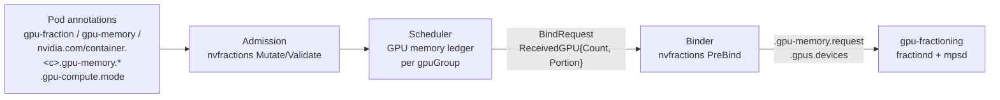

<!--
Copyright 2026 NVIDIA CORPORATION
SPDX-License-Identifier: Apache-2.0
-->

# GPU Compute Fractions

*Status: Draft*

Related: [#2191](https://github.com/kai-scheduler/KAI-Scheduler/issues/2191) (parent), [#2192](https://github.com/kai-scheduler/KAI-Scheduler/issues/2192) (this design), [gpu-fractioning#157](https://github.com/kai-scheduler/gpu-fractioning/issues/157), [gpu-fractioning#163](https://github.com/kai-scheduler/gpu-fractioning/issues/163).
Prior art: [#2341](https://github.com/kai-scheduler/KAI-Scheduler/issues/2341), [#2368](https://github.com/kai-scheduler/KAI-Scheduler/pull/2368), [gpu-fractioning#147](https://github.com/kai-scheduler/gpu-fractioning/pull/147).

## Motivation

GPU fractions in KAI are expressed in GPU memory. The compute a fractional workload receives is whatever its sharing mode happens to give it: an equal turn under `time-slicing`, or an unbounded share of the SMs under `sm-sharing`. Customers of both NVIDIA Run:ai and KAI have repeatedly reported poor performance on memory-only fractions because their workloads were compute-starved, and a latency-sensitive workload has no way to protect itself from a noisy neighbour on the same GPU.

This design lets a fractional workload state how much *compute* it needs, on top of its GPU memory fraction, either as a guaranteed floor that may burst into idle capacity or as a hard ceiling. It ships as **Alpha** in 0.20.

## Goals / Non-Goals

**Goals**

- A user-facing, hardware-agnostic compute share per fractional workload, in two mutually exclusive policies: `min-guaranteed` and `max-allowed`.
- Support for three combinations: `time-slicing` + `min-guaranteed`, `sm-sharing` + `min-guaranteed`, `sm-sharing` + `max-allowed`.
- Fail-fast rejection at admission of every statically invalid submission, with an actionable error.
- Scheduler placement that never over-commits the compute guarantees of a GPU.
- Predictable, discoverable rounding to the granularity the hardware supports.
- A named contract between KAI and [gpu-fractioning](https://github.com/kai-scheduler/gpu-fractioning) for capability discovery and enforcement.
- Zero behaviour change for existing memory-only fractional workloads.

**Non-Goals (deferred to P1)**

- GPU-compute queue `quota` / `limit` parameters. Quota stays counted on GPU memory only.
- Heterogeneous resources.

**Out of scope**

- DRA as the implementation track. The API is chosen to stay portable to DRA (see [Unit and DRA portability](#unit-and-dra-portability)).
- Compute-based fair-share.
- Admin-enforced memory-to-compute ratios inside KAI (admins can enforce them with native Kubernetes policy; see [Fragmentation and fairness](#fragmentation-and-fairness)).
- Per-container compute metrics under `sm-sharing`. MPS does not expose them.
- Normalising compute across GPU models. The same share means different absolute capability on different parts.
- MIG.
- Node-level enforcement internals. They belong to gpu-fractioning and are specified here only as a contract.

## Background: fractions today

In `NvFractions` mode a fractional request flows through four components:



- **Admission** (`pkg/admission/webhook/v1alpha2/nvfractions/`) translates legacy memory keys and validates fraction annotations. Parsing and most rules live in the `github.com/kai-scheduler/api` module (`utilities/resources`); `parseNvFractionsAnnotationKey` rejects any unknown suffix under `nvidia.com/container.`.
- **Scheduler** keeps a per-GPU-group memory ledger in `GpuSharingNodeInfo` (`UsedSharedGPUsMemory`, `AllocatedSharedGPUsMemory`, `ReleasingSharedGPUsMemory`, in `pkg/scheduler/api/node_info/gpu_sharing_node_info.go`). `IsTaskFitOnGpuGroup` checks memory and, via `IsGpuGroupComputeSharingModeCompatible`, keeps `time-slicing` and `sm-sharing` pods on separate GPUs. `gpusharingnodevalidation` requires the node condition `gpu-fractioning.nvidia.com/Ready`.
- **BindRequest** carries `ReceivedGPU{Count, Portion}` and `SelectedFractionalGpuGroups[{ID, ComputeSharingMode}]` (`createBindRequest` in `pkg/scheduler/cache/cache.go`).
- **Binder** (`pkg/binder/plugins/nvfractions/nv_fractions.go`) writes `.gpu-memory.request` (only when the pod has none) and the binder-only `.gpus.devices`. The mode is persisted on the GPU reservation pod.
- **gpu-fractioning** reads the per-container annotations, enforces the memory limit, and routes all `sm-sharing` containers to one shared MPS server with no compute cap. It publishes the node condition above and the label `gpu-fractioning.kai.scheduler/nvidia-driver-version.major`.

There is no compute accounting anywhere in the path today.

## Decision summary

| # | Decision (#2192) | Outcome | Section |
|---|---|---|---|
| 1 | Unit of request | Dimensionless share of one device, `0 < v < 1`. Coherent in both modes: share of the SMs (`sm-sharing`) or share of each time period (`time-slicing`). Portable to DRA as a quantity. | [User API](#user-api) |
| 2 | Naming | `min-guaranteed` (floor, may burst) and `max-allowed` (ceiling, no burst). Not `request` / `limit`. | [Naming](#naming) |
| 3 | Rounding and granularity | Granularity is published per node by gpu-fractioning. The scheduler rounds in the direction that keeps the promise: `min-guaranteed` up, `max-allowed` down; a `max-allowed` smaller than one step makes the node not a fit. The effective value is written on the pod. | [Rounding](#rounding) |
| 4 | Who translates, and where | gpu-fractioning owns hardware translation: it advertises the number of allocation steps and maps a granted share to SMs or time. KAI only does integer step accounting. | [gpu-fractioning contract](#gpu-fractioning-contract) |
| 5 | Who validates and rejects | Admission rejects every statically invalid submission. Co-location that exceeds the device or mixes modes is prevented by construction in the scheduler. | [Validation](#validation) |
| 6 | Device selection and fragmentation | Any memory:compute ratio is allowed. Quota stays memory-only. Enforcing fair ratios is left to the cluster admin. | [Fragmentation and fairness](#fragmentation-and-fairness) |
| 7 | Enforcement per mode | Specified as a per-row contract on gpu-fractioning. The KAI ledger guarantees the sum of floors on a GPU never exceeds its capacity. | [gpu-fractioning contract](#gpu-fractioning-contract) |
| 8 | Defaults and backward compatibility | Memory-only requests are unchanged and remain the default. Nodes without compute capability (e.g. below CUDA 13.5) offer only the existing modes. | [Backward compatibility](#backward-compatibility-and-version-skew) |
| 9 | Observability | Effective share on the pod, compute-specific fit reasons, capability node labels, a per-GPU allocation gauge. Usage is device-level only. | [Observability](#observability) |
| — | Co-location with memory-only pods | Allowed in the same mode. Memory-only pods are best-effort: charged zero compute. | [Compute ledger](#compute-ledger) |
| — | Capability API | Node labels published by gpu-fractioning `mpsd`. | [Capability discovery](#capability-discovery) |
| — | Spec changes and tamper resistance | **Major concern.** Compute keys are immutable after binding. gpu-fractioning is the only path to MPS; no container, root or not, may alter limits. | [Major concern](#major-concern-who-owns-a-spec-change) |
| — | Alpha gating | **Open.** | [Rollout and gating](#rollout-and-gating-open) |

## User API

### Keys

Two new per-container pod annotations, next to the existing `.gpu-compute.mode`:

| Annotation | Value |
|---|---|
| `nvidia.com/container.<c>.gpu-compute.min-guaranteed` | Decimal in `(0, 1)`, at most 5 decimal places |
| `nvidia.com/container.<c>.gpu-compute.max-allowed` | Decimal in `(0, 1)`, at most 5 decimal places |

`<c>` must be the container that holds the GPU memory fraction. There is no pod-level shorthand: the compute mode is already per-container only, and a shorthand can be added later without breaking anything. Workload controllers set the keys on the pod template.

### Semantics

| Mode | Policy | Floor | Ceiling | Bursts into idle capacity | Charged on the GPU |
|---|---|---|---|---|---|
| `time-slicing` | none (memory-only) | — | — | yes, as today | 0 |
| `time-slicing` | `min-guaranteed: v` | `v` of each time period under contention | — | yes | `v`, rounded up |
| `time-slicing` | `max-allowed` | **rejected** | | | |
| `sm-sharing` | none (memory-only) | — | — | yes, as today | 0 |
| `sm-sharing` | `min-guaranteed: v` | `v` of the SMs | — | yes | `v`, rounded up |
| `sm-sharing` | `max-allowed: v` | `v` of the SMs | `v` of the SMs | no | `v`, rounded down |

`max-allowed` is non-work-conserving: the workload receives exactly its share regardless of neighbours. It exists for reproducible, benchmarkable performance: latency-sensitive serving, SLA tiers, multi-tenant resale. Because the ledger keeps the sum of charges on a GPU within its capacity, `max-allowed` is also a guarantee.

A compute share always sits on top of a GPU memory fraction. GPU memory remains the allocating dimension and the only dimension counted against queue quota.

### Examples

**a) Inference serving with a hard ceiling** (`sm-sharing` + `max-allowed`):

```yaml
apiVersion: v1
kind: Pod
metadata:
  name: llm-serving
  labels:
    kai.scheduler/queue: team-a
  annotations:
    nvidia.com/container.server.gpu-memory.request: 20Gi
    nvidia.com/container.server.gpu-compute.mode: sm-sharing
    nvidia.com/container.server.gpu-compute.max-allowed: "0.3"
spec:
  schedulerName: kai-scheduler
  containers:
    - name: server
      image: vllm/vllm-openai
```

**b) Training with a floor and burst.** `time-slicing` is the default mode, so the mode key is omitted. Memory uses the legacy pod-level key:

```yaml
metadata:
  annotations:
    gpu-fraction: "0.25"
    nvidia.com/container.trainer.gpu-compute.min-guaranteed: "0.5"
```

**c) Concurrent kernels with a floor** (`sm-sharing` + `min-guaranteed`):

```yaml
metadata:
  annotations:
    nvidia.com/container.worker.gpu-memory.request: 8Gi
    nvidia.com/container.worker.gpu-compute.mode: sm-sharing
    nvidia.com/container.worker.gpu-compute.min-guaranteed: "0.2"
```

**d) Memory-only, unchanged** (best-effort compute, as today):

```yaml
metadata:
  annotations:
    gpu-fraction: "0.5"
```

**What the user sees after binding.** On a node that advertises 7 allocation steps for `sm-sharing` and 100 for `time-slicing` (see [Capability discovery](#capability-discovery)), the binder writes:

| Example | Requested | Steps | Effective annotation |
|---|---|---|---|
| a | `max-allowed: 0.3` | 0.3 × 7 = 2.1 → **2** (down) | `nvidia.com/container.server.gpu-compute.effective-max-allowed: "0.2857"` |
| b | `min-guaranteed: 0.5` | 0.5 × 100 = **50** | `nvidia.com/container.trainer.gpu-compute.effective-min-guaranteed: "0.5000"` |
| c | `min-guaranteed: 0.2` | 0.2 × 7 = 1.4 → **2** (up) | `nvidia.com/container.worker.gpu-compute.effective-min-guaranteed: "0.2857"` |

Example c is the "20% resolves to 28%" case raised in #2192.

**Rejected at admission:**

| Submission | Error |
|---|---|
| `min-guaranteed: "0.3"` and `max-allowed: "0.5"` | `gpu-compute.min-guaranteed and gpu-compute.max-allowed are mutually exclusive` |
| `max-allowed: "0.3"` with no memory key | `gpu-compute.max-allowed requires a GPU memory fraction (gpu-fraction, gpu-memory or .gpu-memory.request)` |
| `max-allowed: "0.3"` under `time-slicing` (explicit or default) | `gpu-compute.max-allowed is supported only with gpu-compute.mode=sm-sharing` |
| `min-guaranteed: "1"`, `"0"` or `"abc"` | `gpu-compute.min-guaranteed must be a decimal in (0, 1)` |

**Pending, with a reason** (scheduler fit errors, surfaced as events and PodGroup conditions):

- `node n1 does not support GPU compute fractions (sm-sharing, max-allowed)`: the node has no capability label, for example because its driver is below CUDA 13.5.
- `node n1 has enough GPU memory but not enough GPU compute (requested 2/7, free 1/7)`
- `node n1 cannot honour gpu-compute.max-allowed 0.05: smaller than one compute step (1/7)`: a finer-grained node may still fit.

### Naming

`request` / `limit` was rejected because the behaviour does not match the Kubernetes meaning: the two cannot be combined, and the "limit" here is also a guarantee. Reusing the words would also collide with the planned per-queue compute `limit` (P1). `dynamic` / `static` describes the enforcement mechanism rather than what the user is promised. `min-guaranteed` / `max-allowed` states the promise directly and leaves `quota` / `limit` free for queues.

### Unit and DRA portability

A dimensionless share is the only unit that means something in both modes: `sm-sharing` divides the device spatially (concurrent SMs), `time-slicing` divides it temporally (all SMs for a share of each period). An SM count is meaningless under `time-slicing`.

The share is also a quantity, not just a proportion. A DRA driver can advertise a consumable `compute` capacity of `1` per device, and a share of `0.3` becomes a request of `300m`. DRA consumable capacity ([KEP-5075](https://kep.k8s.io/5075)) already expresses granularity as `requestPolicy.validRange.step` and rounds a request *up* to the next step. That matches `min-guaranteed`. A `max-allowed` ceiling has no DRA rounding equivalent; on that track it would need step-aligned requests or a driver-side round-down.

## Validation

All static rules are enforced in one place, the admission webhook, so they fail at `kubectl apply` time. Parsing and the rules live in the api module (`ExtractNvFractionsData`, `parseNvFractionsAnnotationKey`, `ValidateGPUFractionRequest`); `pkg/admission/webhook/v1alpha2/nvfractions/validation.go` calls them.

| Rule | Rejected when |
|---|---|
| Range | The value does not parse, has more than 5 decimals, or is outside `(0, 1)`. |
| Exclusive | Both `min-guaranteed` and `max-allowed` are set. |
| Needs memory | A compute key is set and the pod has no memory fraction (`gpu-fraction`, `gpu-memory`, `.gpu-memory.request` or `.gpu-memory.limit`). This also rules out whole-GPU pods. |
| Mode | `max-allowed` is set and the mode is `time-slicing`, explicitly or by default. |
| Container | The compute key names a container other than the fraction container. |
| Sharing mode | The cluster is not in `NvFractions` mode. The `gpusharing` admission plugin accepts `.gpu-compute.mode` today, so the rejection of compute keys there is new and explicit (it shares `ValidateGPUFractionRequest` with `nvfractions`). |
| Gate | The Alpha switch is off, if one is adopted (see [Rollout and gating](#rollout-and-gating-open)). |
| Binder-owned | A non-binder identity adds, changes or removes an `effective-*` key. Same protection as `.gpus.devices`, extended to removal. |
| Immutable | A compute key is added, changed or removed on a pod that is already bound. The runtime cannot apply a live change; see [Major concern](#major-concern-who-owns-a-spec-change). |

The third rejection listed in #2191, a co-location whose guarantees exceed the device or that mixes sharing modes, is not a property of a single submission and cannot be checked at admission. The scheduler prevents it by construction: mode separation already exists (`IsGpuGroupComputeSharingModeCompatible`), and the compute ledger below never lets the sum of charges on a GPU exceed its capacity. A pod that cannot be placed waits with an explicit compute reason, like any pod waiting for capacity.

Rejecting a compute pod at admission when no node in the cluster is capable was considered and rejected: capable nodes may join later (autoscaling, driver upgrades), and admission would depend on cluster state.

## Capability discovery

gpu-fractioning's `mpsd` DaemonSet already labels each node with its driver version. It is extended to query the driver and MPS for compute-sharing capability and to publish one label per supported (mode, policy) row:

```yaml
gpu-fractioning.kai.scheduler/compute.sm-sharing.max-allowed.steps: "7"
gpu-fractioning.kai.scheduler/compute.sm-sharing.min-guaranteed.steps: "7"
gpu-fractioning.kai.scheduler/compute.time-slicing.min-guaranteed.steps: "100"
```

- **Value:** `N`, the number of indivisible allocation steps per GPU in that mode. One step is `1/N` of the device. All rows of the same mode advertise the same `N`; the scheduler treats a mismatch as not capable.
- **Absence means not capable.** A node below CUDA 13.5, a node with MIG-enabled GPUs, or a node whose gpu-fractioning cannot honour a row simply has no label for it. This is the per-node CUDA version check: KAI never parses driver versions.
- **Per-row gating** lets a row ship as soon as gpu-fractioning can honour it. `sm-sharing` + `max-allowed` is already proven ([gpu-fractioning#147](https://github.com/kai-scheduler/gpu-fractioning/pull/147)); `min-guaranteed` with burst can follow.
- **Homogeneous GPUs per node** are assumed, as `nvidia.com/gpu.memory` already assumes.
- **Discoverable:** `kubectl get nodes -L gpu-fractioning.kai.scheduler/compute.sm-sharing.max-allowed.steps`.

Labels are recomputed on `mpsd` start and on driver change. Removing a label makes the node ineligible for new compute pods; running pods are unaffected. A node's `N` may change only while no compute pods run on it (driver upgrades drain the node); see the contract.

This proposal is the KAI input to [gpu-fractioning#163](https://github.com/kai-scheduler/gpu-fractioning/issues/163).

## Design

### Request parsing

`NvFractionsContainerRequest` and `PodGPUFractionRequest` in the api module gain the policy and the share. `PodInfo.updatePodAdditionalFields` (`pkg/scheduler/api/pod_info/pod_info.go`) carries them into the task's GPU requirement. Shares are parsed as fixed-point integers (units of `1e-5`), never as floats, so `0.29 × 100` is exactly `29`.

For a bound pod (`spec.nodeName` set) the scheduler reads the binder-written `effective-*` key rather than recomputing from the request, so a scheduler restart rebuilds the ledger from what was granted. The key alone is not proof of a grant: binder annotations are patched before the Binding call and are not removed on rollback, so a pod whose bind failed may still carry one. As a defensive measure, a share that does not map to a whole step under the node's current `N` is charged `ceil(v · N)`.

### Node filter

`gpusharingnodevalidation` (`pkg/scheduler/plugins/gpusharingnodevalidation/`), which already gates `NvFractions` pods on the `gpu-fractioning.nvidia.com/Ready` condition, additionally requires the capability label for the pod's (mode, policy). A missing label produces the "does not support GPU compute fractions" fit error.

### Rounding

The effective number of steps is computed per candidate node, from that node's `N`:

| Policy | Steps | Why |
|---|---|---|
| `min-guaranteed` | `ceil(v · N)` | The floor is never below what was promised. |
| `max-allowed` | `floor(v · N)`; if that is 0, the node is not a fit | The ceiling is never above what was promised. |

The same request can therefore resolve to different effective shares on different GPU models. The value is fixed at allocation and written on the pod.

### Compute ledger

`GpuSharingNodeInfo` gains `UsedSharedGPUsCompute`, `AllocatedSharedGPUsCompute` and `ReleasingSharedGPUsCompute`, keyed by GPU group, in integer steps. They mirror the memory ledger through its whole lifecycle: `addSharedGPUTaskResourcesPerPodGroup` / `removeSharedTaskResourcesPerPodGroup`, pipelining onto releasing capacity, and statement rollback (`pkg/scheduler/framework/statement.go`).

- **Capacity** of each GPU is the node's `N` for the group's mode.
- **Charge** is the task's effective steps. Memory-only pods are charged zero and run on whatever the guarantees leave, plus idle capacity.
- **Fit:** `IsTaskFitOnGpuGroup` adds a compute check for compute pods that mirrors `enoughResourcesOnGpu`: `N − allocated + releasing − steps ≥ 0` (`Used` already includes `Allocated`). `FittingGPUs` (`framework/session.go`) inherits it. The failure message is "enough GPU memory but not enough GPU compute", instead of today's GPU memory message.
- **Bind now or pipeline:** `EnoughIdleResourcesOnGpu` (`pkg/scheduler/gpu_sharing/gpuSharing.go`) gets the same compute term without `releasing`, so a compute pod is never bound immediately onto compute that is still being released.
- **Topology pre-filter:** `AvailableSharedGPUFractions` (used by `pkg/scheduler/plugins/topology/job_filtering.go`) stays memory-based for the Alpha. For compute pods it can over-estimate free capacity in a domain; the cost is a wasted simulation, never a wrong placement, because the fit check above still applies.
- `min-guaranteed` and `max-allowed` pods of the same mode may share a GPU; both are charged.
- **Multi-device** requests (`gpu-fraction-num-devices`): the share applies per device, and each GPU group is charged.
- **Burst capacity is never allocated.** A `min-guaranteed` workload bursting above its floor holds no ledger entry for the excess. When the scheduler places a new guarantee on that GPU, giving back the burst is the runtime's job (see the contract). This is unrelated to KAI's reclaim action.

### Quota and fair share

Unchanged. A fractional pod is charged its memory portion (`pkg/scheduler/plugins/proportion/proportion.go`), whatever its compute share. GPU ordering (`gpupack` / `gpuspread`) and victim selection are unchanged. Compute-aware packing is future work ([#1373](https://github.com/kai-scheduler/KAI-Scheduler/issues/1373)).

### BindRequest

`ReceivedGPU` in `github.com/kai-scheduler/api` (`scheduling/v1alpha2/bindrequest_types.go`) gains two optional decimal strings, at most one of them set:

```go
type ReceivedGPU struct {
	Count   int    `json:"count,omitempty"`
	Portion string `json:"portion,omitempty"`
	// Effective compute share per device, after rounding. Empty for memory-only pods.
	ComputeMinGuaranteed string `json:"computeMinGuaranteed,omitempty"`
	ComputeMaxAllowed    string `json:"computeMaxAllowed,omitempty"`
}
```

The api change, with the new annotation constants and validation, lands first in the api module. After a tag, `go.mod` is bumped here.

### Binder

The nvfractions `PreBind` writes the effective share from the BindRequest onto the workload container:

- `nvidia.com/container.<c>.gpu-compute.effective-min-guaranteed`, or
- `nvidia.com/container.<c>.gpu-compute.effective-max-allowed`

The value has 4 decimal places. gpu-fractioning recovers the step count as `round(v · N)`, which is exact for any `N ≤ 5000`. A share, rather than a step count, keeps the user-visible value hardware-agnostic. The binder overwrites any existing value: the grant is imposed on the workload, not requested by it.

### Metrics

A scheduler gauge, `gpu_compute_allocated_portion{node, gpu_group, mode}`, rebuilt every session, reports the sum of compute charges per shared GPU.

## gpu-fractioning contract

KAI decides how much compute each container gets. gpu-fractioning decides how. The contract:

**Inputs.** At container creation fractiond reads `.gpu-compute.mode` and at most one `effective-*` key per container. A container with neither key is best-effort.

**Guarantees, per advertised row:**

| Row | Must guarantee |
|---|---|
| `sm-sharing` + `max-allowed` | The container never uses more than its share of the SMs, and always has access to that share. |
| `sm-sharing` + `min-guaranteed` | The container always has access to at least its share of the SMs, and may use idle SMs beyond it. |
| `time-slicing` + `min-guaranteed` | Under contention the container receives at least its share of each time period (weighted time-slicing). Idle time is redistributed. The period is fixed by the lower-level API; KAI only supplies the share. |

**Across all rows:**

- **Best-effort containers** on the same GPU must not reduce any container below its guarantee.
- **Graceful reclaim.** When a burst must be given back, SMs are drained and the in-flight operation completes first. The latency cost is documented by gpu-fractioning.
- **Sole owner of MPS.** Only gpu-fractioning applies or changes a grant. No container, root or not, can raise its own share or alter a neighbour's. See [Major concern](#major-concern-who-owns-a-spec-change).
- **Advertise honestly.** A row's label is published only when every guarantee of that row holds on that node.
- **Stable granularity.** `N` changes only while no compute pods run on the node, so granted shares always map to whole steps.

**Owner.** gpu-fractioning ([#157](https://github.com/kai-scheduler/gpu-fractioning/issues/157), [#163](https://github.com/kai-scheduler/gpu-fractioning/issues/163)). Named owner: **TBD**.

## Major concern: who owns a spec change

> **This concern blocks the guarantees from being meaningful.** A floor or ceiling is only as strong as the weakest path to change it. Today no component owns a change to a running fractional pod's spec, and a root container can reach MPS control directly.

### What happens today with GPU memory

A user edits `.gpu-memory.request`, `.gpu-memory.limit` or `gpu-fraction` on a running pod:

| Component | Behaviour | Source |
|---|---|---|
| Admission | Validates the new value only; memory keys are not immutable after binding. The edit is accepted. | `pkg/admission/webhook/v1alpha2/nvfractions/validation.go` |
| Scheduler | Re-parses every pod's annotations each session, bound pods included, and does not use the BindRequest grant. The ledger follows the edit immediately. | `PodInfo.updatePodAdditionalFields` → `ParsePodGPUFractionRequest` |
| Binder | Not involved after binding. | — |
| gpu-fractioning | fractiond reads annotations once, in the NRI `CreateContainer` hook; there is no `UpdateContainer` hook and no pod watch. The memory limit is set on the container cgroup through NVML by the NVIDIA container toolkit CDI hook before the workload starts. Nothing changes for the running container. | fractiond `plugin.go`, `injection/injection.go` |

The scheduler and the runtime therefore disagree. Shrinking the annotation frees ledger capacity that the runtime still hands to the pod, so the scheduler can place a neighbour and over-commit the GPU. This is a latent issue in memory fractions today, independent of compute.

### Why compute makes it worse

- **A cap cannot change under a running client.** MPS rejects `namespace set` while a client is attached; [gpu-fractioning#147](https://github.com/kai-scheduler/gpu-fractioning/pull/147) restarts the container instead ("Changing a running pod's portion therefore requires restarting it").
- **Root is owner-equivalent to the MPS server.** Every workload container is given an MPS pipe, which clients need. Under `time-slicing` the whole `/run/nvidia-mps` directory, control socket included, is mounted read-write. A non-owner uid is refused mutating commands, but a root container could raise its own cap or delete a neighbour's namespace. #147 states non-root as a requirement but does not enforce it.
- **One tenant breaks everyone.** The ledger's promise that the guarantees on a GPU sum to at most its capacity holds only if every tenant stays inside its cap. A single tenant that escapes, including a memory-only one, voids the guarantees of all its neighbours.

### Proposal

| Owner | Responsibility |
|---|---|
| **gpu-fractioning** | The only component that applies or changes a grant on MPS. A spec change reaches MPS only through gpu-fractioning (fractiond → mpsd → MPS control, as in #147), never from the workload. No container, root or not, may alter its own limits or a neighbour's. How is gpu-fractioning's choice: not exposing the control socket, per-tenant servers, user namespaces, refusing root clients. |
| **KAI** | Compute keys are immutable once the pod is bound (admission), because the runtime cannot apply a live change. The scheduler accounts a bound pod from its grant (`effective-*`), never from an edited request. |
| **Docs, until gpu-fractioning closes the gap** | Guarantees assume every tenant on the GPU runs as non-root. Stated as a known limitation of the Alpha. |

**Separate fix (not part of this design):** make the memory keys immutable after binding, or account bound pods from what the BindRequest granted, so memory fractions stop drifting from what the runtime enforces.

In-place changes of a compute share are out of scope for the Alpha. If they are added, they follow the same path: KAI admits and re-accounts the change, and gpu-fractioning applies it, restarting the container where MPS requires it.

## Observability

| What | Where |
|---|---|
| Effective (rounded) share granted | `effective-*` annotation on the pod |
| Why a pod is pending | Compute-specific fit reasons in events and PodGroup conditions |
| Which nodes are capable, and their granularity | `compute.*.steps` node labels |
| Compute allocated per GPU | `gpu_compute_allocated_portion` scheduler gauge |
| Device-level SM utilisation | gpu-fractioning metricsd (`gpu_fractioning_gpu_sm_utilization_percent`) |

**Documented limitation:** per-container compute usage is not observable under `sm-sharing`; MPS provides no per-client counters. Users see what was *granted* and how busy the *device* is, not what each container consumed.

## Fragmentation and fairness

Any memory:compute ratio is valid: a workload may request 1% of the memory and 99% of the compute, or the reverse. The application owner is responsible for using what was requested. The consequences are accepted for the Alpha and documented:

- **Stranded capacity.** A GPU can run out of compute while memory is free, or the reverse.
- **Quota escape.** Quota counts memory only, so a queue can take compute well beyond its memory-based share.

Admins who need a policy can enforce one today with native Kubernetes admission policy; no KAI code is involved. For example, capping any compute share at half a GPU:

```yaml
apiVersion: admissionregistration.k8s.io/v1
kind: ValidatingAdmissionPolicy
metadata:
  name: cap-gpu-compute-share
spec:
  failurePolicy: Fail
  matchConstraints:
    resourceRules:
      - apiGroups: [""]
        apiVersions: ["v1"]
        operations: ["CREATE"]
        resources: ["pods"]
  validations:
    - expression: >-
        !has(object.metadata.annotations) ||
        object.metadata.annotations.all(k,
          !(k.endsWith('.gpu-compute.min-guaranteed') || k.endsWith('.gpu-compute.max-allowed')) ||
          double(object.metadata.annotations[k]) <= 0.5)
      message: "GPU compute shares above 0.5 are not allowed in this namespace"
```

A `ValidatingAdmissionPolicyBinding` scopes it to the namespaces the admin chooses.

The structural fix is P1: a `gpu-compute` queue resource, along the lines of the `gpu-compute` AccountedResource in [`accounted-resource-api.md`](../accounted-resource-api.md).

## Backward compatibility and version skew

- **Memory-only pods** are unchanged: same placement, same quota, same runtime behaviour. They remain the default.
- **Nodes without capability** (below CUDA 13.5, older gpu-fractioning, MIG) only offer the existing `1/n` modes.
- **New KAI, old gpu-fractioning:** no labels, so compute pods stay pending with an explicit reason. Fail safe: a compute share is never accepted and then left unenforced.
- **Old KAI, new gpu-fractioning:** admission already rejects unknown `nvidia.com/container.` suffixes, so compute keys fail at submission.
- **Scheduler and binder** ship together in one KAI release; an older binder would ignore the new BindRequest fields and leave the share unenforced.
- **Downgrade and partial upgrade.** An older scheduler's `ExtractNvFractionsData` fails on unknown `nvidia.com/container.` suffixes, and `updatePodAdditionalFields` then drops the pod's GPU requirement: a bound compute pod is charged zero GPU memory, and a pending one is scheduled as CPU-only. Two mitigations:
  - A preparatory release in which scheduler-side parsing ignores unknown suffixes, while admission stays strict. Downgrading below that release with compute pods running is unsupported.
  - Compute keys are admitted only once every component runs the new release. A KAI switch enabled after the upgrade gives this for free (see [Rollout and gating](#rollout-and-gating-open)); without one, the operator must upgrade the scheduler before admission.
- **node-scale-adjuster** is unchanged. Scale-up stays GPU-count based; a new node becomes eligible once `mpsd` labels it.

## Rollout and gating (open)

The capability labels already gate *where* compute pods can run. Open question: should KAI also have its own Alpha switch?

| | KAI switch (default off) + capability labels | Capability labels only |
|---|---|---|
| Opt-in | Explicit cluster-wide opt-in to an Alpha API | Implicit, once gpu-fractioning advertises |
| Off switch | Admins can disable on the KAI side alone | Requires reconfiguring gpu-fractioning |
| Clusters with no capable nodes | Rejected at admission with "feature disabled" | Accepted, then pending with a reason |
| Upgrade window | Compute keys are admitted only after the admin enables the switch, i.e. after every component is upgraded | Admission may accept compute keys while an older scheduler is still running; needs a strict upgrade order |
| Cost | Two switches to keep aligned. KAI registers no feature gates of its own today: `--feature-gates` is wired on scheduler, admission and binder, but only upstream gates are defined. A KAI gate or a Config/Helm field would be the first. | None |

Current lean: a KAI switch, default off, plus capability labels.

## Alternatives considered

| Alternative | Why not |
|---|---|
| `request` / `limit` naming | Does not match Kubernetes semantics; collides with the P1 queue `limit`. |
| `dynamic` / `static` naming | Names the mechanism, not the promise. |
| SM count as the unit | Meaningless under `time-slicing`; exposes hardware structure. |
| Rounding to nearest | Can break either promise by half a step. |
| Charging quota `max(memory, compute)` | Changes quota semantics for an Alpha; compute quota is planned as its own resource. |
| Enforcing a memory:compute ratio in KAI | Out of scope; admins can do it with native policy. |
| Charging memory-only pods compute equal to their memory share | Changes how many memory-only pods fit next to compute pods, which breaks "unchanged". |
| Segregating memory-only and compute pods on separate GPUs | Worst fragmentation. |
| Per-node CRD for capability | New CRD, informer and RBAC for a few scalars per node. |
| DRA ResourceSlice attributes for capability | Pulls in DRA, which is out of scope. |
| Synchronous query to gpu-fractioning | The scheduler session cannot do network I/O. |
| Validating co-location at admission | Not a property of a single submission. |
| Pod-level shorthand keys | The mode is per-container only; can be added later. |

## Open questions

1. **Alpha gating:** KAI switch plus capability, or capability only (see above).
2. **MPS burst and graceful reclaim feasibility.** MPS cannot currently tell which client is using more than its floor ([comment on #2191](https://github.com/kai-scheduler/KAI-Scheduler/issues/2191#issuecomment-6373696283)). Whether CUDA 13.5 gives gpu-fractioning what it needs for `sm-sharing` + `min-guaranteed` is unconfirmed. Per-row labels let `max-allowed` ship regardless.
3. **Root and best-effort containers under MPS.** How gpu-fractioning keeps root containers and memory-only `sm-sharing` containers from eroding guarantees (see [Major concern](#major-concern-who-owns-a-spec-change)).
4. **MIG.** Confirm that MIG-enabled GPUs are invisible to fractions and that `mpsd` never advertises them.
5. **Time-slicing period.** Which lower-level API fixes it, and whether its length should be documented to users.
6. **Effective key names.** `effective-min-guaranteed` / `effective-max-allowed` are placeholders.
7. **Named owner** for the gpu-fractioning work.

## Implementation breakdown

Each item becomes a sub-issue of #2191 and is independently mergeable, in order:

0. **Preparatory release:** scheduler-side parsing ignores unknown `nvidia.com/container.` suffixes (admission stays strict). Ships at least one release before compute keys are accepted.
1. **api module:** annotation constants, parsing, validation rules, `ReceivedGPU` fields; tag and `go.mod` bump.
2. **Admission:** wire the new rules, binder-owned and immutable keys, rejection in `gpusharing` mode.
3. **Scheduler:** capability filter, rounding, compute ledger, fit errors, gauge.
4. **Binder:** write `effective-*` keys.
5. **gpu-fractioning:** capability labels and per-row enforcement (separate repository).
6. **Docs:** a "Compute fractions" section in `docs/gpu-sharing/nv-fraction`.
7. **E2E:** see the test plan.

## Test plan

- **Unit (api module):** parsing, every admission rule, fixed-point rounding at step boundaries.
- **Unit (scheduler):** ledger add/remove/release/rollback; fit with mixed `min-guaranteed`, `max-allowed` and memory-only pods; per-node rounding with different `N`; the capability filter.
- **Scheduler action tests** with fake nodes carrying capability labels (`pkg/scheduler/test_utils/nodes_fake`).
- **Binder:** `effective-*` annotations written and overwritten; admission blocks non-binder edits and removal.
- **E2E:** the capability labels are stamped on simulated nodes (as `stampNvFractionsNodes` in `test/e2e/scale/kwok_fraction_scenarios.go` stamps the readiness condition today), covering placement, rejection and pending reasons. Enforcement itself is covered by gpu-fractioning's own tests on real GPUs.
