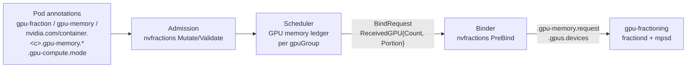
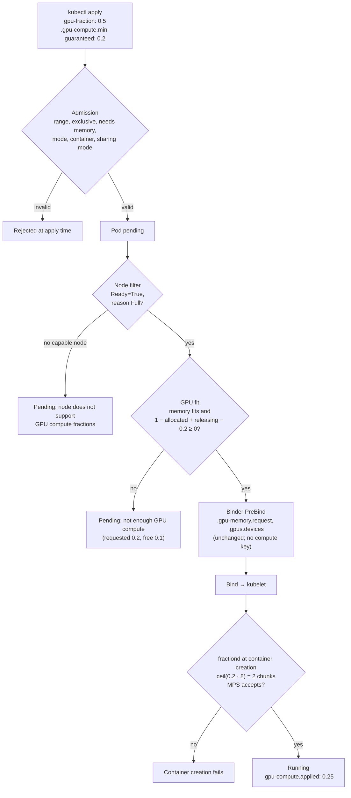

<!--
Copyright 2026 NVIDIA CORPORATION
SPDX-License-Identifier: Apache-2.0
-->

# GPU Compute Fractions

*Status: Draft*

Related: [#2191](https://github.com/kai-scheduler/KAI-Scheduler/issues/2191) (parent), [#2192](https://github.com/kai-scheduler/KAI-Scheduler/issues/2192) (this design), [gpu-fractioning#157](https://github.com/kai-scheduler/gpu-fractioning/issues/157), [gpu-fractioning#163](https://github.com/kai-scheduler/gpu-fractioning/issues/163).
Prior art: [#2341](https://github.com/kai-scheduler/KAI-Scheduler/issues/2341), [#2368](https://github.com/kai-scheduler/KAI-Scheduler/pull/2368), [gpu-fractioning#147](https://github.com/kai-scheduler/gpu-fractioning/pull/147).

## Motivation

GPU fractions in KAI are expressed in GPU memory. The compute a fractional workload receives is whatever its sharing mode happens to give it: an equal turn under `time-slicing`, or an unbounded share of the SMs under `sm-sharing`. Customers of both NVIDIA Run:ai and KAI have repeatedly reported poor performance on memory-only fractions because their workloads were compute-starved, and a latency-sensitive workload has no way to protect itself from a noisy neighbour on the same GPU.

This design lets a fractional workload state how much *compute* it needs, on top of its GPU memory fraction, either as a guaranteed floor that may burst into idle capacity or as a hard ceiling. It ships as **Alpha** in 0.20.

## Goals / Non-Goals

**Goals**

- A user-facing, hardware-agnostic compute share per fractional workload, in two mutually exclusive policies: `min-guaranteed` and `max-allowed`.
- Support for three combinations: `time-slicing` + `min-guaranteed`, `sm-sharing` + `min-guaranteed`, `sm-sharing` + `max-allowed`.
- Fail-fast rejection at admission of every statically invalid submission, with an actionable error.
- Scheduler placement that never over-commits the compute guarantees of a GPU.
- Rounding to the hardware's granularity owned by gpu-fractioning and visible on the pod, the same split as GPU memory today.
- A named contract between KAI and [gpu-fractioning](https://github.com/kai-scheduler/gpu-fractioning) for capability discovery and enforcement.
- Zero behaviour change for existing memory-only fractional workloads.

**Non-Goals**

- GPU-compute queue `quota` / `limit` parameters (deferred to P1). Quota stays counted on GPU memory only.
- Heterogeneous resources (deferred to P1).
- Resizing a running fractional pod in place, for memory or compute. It is not supported, and the user docs say so.

**Out of scope**

- DRA as the implementation track. The API is chosen to stay portable to DRA (see [Unit and DRA portability](#unit-and-dra-portability)).
- Compute-based fair-share.
- Admin-enforced memory-to-compute ratios inside KAI (admins can enforce them with native Kubernetes policy; see [Fragmentation and fairness](#fragmentation-and-fairness)).
- Per-container compute metrics under `sm-sharing`. MPS does not expose them.
- Normalising compute across GPU models. The same share means different absolute capability on different parts.
- MIG.
- Node-level enforcement internals. They belong to gpu-fractioning and are specified here only as a contract.

## Glossary

| Term | Meaning |
|---|---|
| **Share** | A dimensionless fraction of one GPU's compute, `0 < v < 1`: a share of the SMs under `sm-sharing`, or a share of each time period under `time-slicing`. |
| **Chunk** | The smallest indivisible unit of compute gpu-fractioning can configure on a GPU, e.g. `1/8` of the SMs. Internal to gpu-fractioning: KAI never sees it. |
| **`min-guaranteed`** | Policy: the container always gets at least its share and may burst into idle capacity. |
| **`max-allowed`** | Policy: the container gets exactly its share, never more. Also a guarantee. |
| **Applied share** | The share gpu-fractioning actually configured for the container after rounding the request to its chunks, e.g. a request of `0.2` on a GPU with 8 chunks is applied as `0.25`. Written on the pod by gpu-fractioning. |
| **Compute sharing mode** | `time-slicing` (default) or `sm-sharing` (MPS), set by `.gpu-compute.mode`. Pods of different modes never share a GPU. |
| **Best-effort** | A memory-only fractional pod. It holds no compute guarantee and runs on whatever capacity the guarantees leave. |
| **Node tier** | `none`, `memory` or `full`: what fraction sharing a node supports, from its CUDA and driver versions. |

## Background: fractions today

In `NvFractions` mode a fractional request flows through four components:



- **Admission** (`pkg/admission/webhook/v1alpha2/nvfractions/`) translates legacy memory keys and validates fraction annotations. Parsing and most rules live in the `github.com/kai-scheduler/api` module (`utilities/resources`); `parseNvFractionsAnnotationKey` rejects any unknown suffix under `nvidia.com/container.`.
- **Scheduler** keeps a per-GPU-group memory ledger in `GpuSharingNodeInfo` (`UsedSharedGPUsMemory`, `AllocatedSharedGPUsMemory`, `ReleasingSharedGPUsMemory`, in `pkg/scheduler/api/node_info/gpu_sharing_node_info.go`). `IsTaskFitOnGpuGroup` checks memory and, via `IsGpuGroupComputeSharingModeCompatible`, keeps `time-slicing` and `sm-sharing` pods on separate GPUs. `gpusharingnodevalidation` requires the node condition `gpu-fractioning.nvidia.com/Ready`.
- **BindRequest** carries `ReceivedGPU{Count, Portion}` and `SelectedFractionalGpuGroups[{ID, ComputeSharingMode}]` (`createBindRequest` in `pkg/scheduler/cache/cache.go`).
- **Binder** (`pkg/binder/plugins/nvfractions/nv_fractions.go`) writes `.gpu-memory.request` (only when the pod has none) and the binder-only `.gpus.devices`. The mode is persisted on the GPU reservation pod.
- **gpu-fractioning** reads the per-container annotations, enforces the memory limit, and routes all `sm-sharing` containers to one shared MPS server with no compute cap. It publishes the node condition above and the label `gpu-fractioning.kai.scheduler/nvidia-driver-version.major`. Its only version threshold is a driver-major floor (615) that explains an already-failing node rather than gating one (see [Node support tiers](#node-support-tiers)).

There is no compute accounting anywhere in the path today.

## Decision summary

| # | Decision (#2192) | Outcome | Section |
|---|---|---|---|
| 1 | Unit of request | Dimensionless share of one device, `0 < v < 1`. Coherent in both modes: share of the SMs (`sm-sharing`) or share of each time period (`time-slicing`). Portable to DRA as a quantity. | [User API](#user-api) |
| 2 | Naming | `min-guaranteed` (floor, may burst) and `max-allowed` (ceiling, no burst). Not `request` / `limit`. | [Alternatives](#alternatives-considered) |
| 3 | Rounding and granularity | Owned by gpu-fractioning, as MiB rounding is for GPU memory. KAI accounts the requested share exactly and never sees chunks. gpu-fractioning rounds at container creation in the direction that keeps the promise and writes the applied share on the pod. | [Rounding](#rounding) |
| 4 | Who translates, and where | gpu-fractioning owns hardware translation: it maps a share to chunks of SMs or time, and reports the applied share back. KAI only accounts shares. Same split as the memory handshake. | [gpu-fractioning contract](#gpu-fractioning-contract) |
| 5 | Who validates and rejects | Admission rejects every statically invalid submission. Co-location that exceeds the device or mixes modes is prevented by construction in the scheduler. | [Validation](#validation) |
| 6 | Device selection and fragmentation | Any memory:compute ratio is allowed. Quota stays memory-only. Enforcing fair ratios is left to the cluster admin. | [Fragmentation and fairness](#fragmentation-and-fairness) |
| 7 | Enforcement per mode | Specified as a per-row contract on gpu-fractioning. The KAI ledger guarantees the sum of requested shares on a GPU never exceeds 1; gpu-fractioning must honour any such set after rounding. | [gpu-fractioning contract](#gpu-fractioning-contract) |
| 8 | Defaults and backward compatibility | Memory-only requests are unchanged and remain the default. Nodes are in one of three tiers, computed by gpu-fractioning from the CUDA and driver versions (ANDed): `none` (< CUDA 13.4), `memory` (CUDA 13.4), `full` (≥ CUDA 13.5). `memory`-tier nodes keep offering memory fractions. | [Node support tiers](#node-support-tiers) |
| 9 | Observability | Applied share on the pod, compute-specific fit reasons, the node tier on the `Ready` reason, a per-GPU allocation gauge. Usage is device-level only. | [Observability](#observability) |
| — | Co-location with memory-only pods | Allowed in the same mode. Memory-only pods are best-effort: charged zero compute. | [Compute ledger](#compute-ledger) |
| — | Capability API | The tier travels on the `Ready` condition KAI already reads: `False` for `none`, `True` with reason `MemoryOnly` for `memory`, `True` with reason `Full` for `full`. No new labels. | [Capability discovery](#capability-discovery) |
| — | KAI ⇄ gpu-fractioning API | Request (user) → tier (`Ready` reason) → applied share (gpu-fractioning). The request key is read by both sides as is; KAI adds no compute key. | [KAI ⇄ gpu-fractioning API](#kai--gpu-fractioning-api) |
| — | Spec changes | Resizing is a non-goal. Compute keys are immutable after binding. | [Spec changes after binding](#spec-changes-after-binding) |
| — | Alpha gating | No KAI switch. Alpha is marked in the docs only. Compute keys take effect when the scheduler runs in `NvFractions` GPU sharing mode, on `full`-tier nodes. | [Rollout and gating](#rollout-and-gating) |

## User API

### Keys

Two new per-container pod annotations, next to the existing `.gpu-compute.mode`:

| Annotation | Value |
|---|---|
| `nvidia.com/container.<c>.gpu-compute.min-guaranteed` | Decimal in `(0, 1)`, at most 5 decimal places |
| `nvidia.com/container.<c>.gpu-compute.max-allowed` | Decimal in `(0, 1)`, at most 5 decimal places |

`<c>` must be the container that holds the GPU memory fraction. There is no pod-level shorthand: the compute mode is already per-container only, and a shorthand can be added later without breaking anything. Workload controllers set the keys on the pod template.

### Semantics

| Mode | Policy | Floor | Ceiling | Beyond the floor | Ledger charge |
|---|---|---|---|---|---|
| `time-slicing` | none (memory-only) | — | — | No share of its own: the driver round-robins between busy containers, about `1/n` each, as today | 0 |
| `time-slicing` | `min-guaranteed: v` | `v` of each time period under contention | — | Bursts into the idle time of neighbours | `v` |
| `time-slicing` | `max-allowed` | **rejected** | | | |
| `sm-sharing` | none (memory-only) | — | — | No partition: competes for all SMs, as today | 0 |
| `sm-sharing` | `min-guaranteed: v` | `v` of the SMs | — | Bursts into idle SMs | `v` |
| `sm-sharing` | `max-allowed: v` | `v` of the SMs | `v` of the SMs | No burst | `v` |

Floor and ceiling are `v` rounded by gpu-fractioning to its granularity, up for a floor and down for a ceiling (see [Rounding](#rounding)). The ledger charge is what the pod deducts from the GPU's compute capacity of `1` in the scheduler's [compute ledger](#compute-ledger).

Today's `time-slicing` gives each container its own MPS context on the default socket, and the driver time-slices those contexts with equal weight. Weighted time-slicing for `min-guaranteed` is new work in gpu-fractioning.

`max-allowed` is non-work-conserving: the workload receives exactly its share regardless of neighbours. It exists for reproducible, benchmarkable performance: latency-sensitive serving, SLA tiers, multi-tenant resale. Because the ledger keeps the sum of charges on a GPU within its capacity, `max-allowed` is also a guarantee.

A compute share always sits on top of a GPU memory fraction. GPU memory remains the allocating dimension and the only dimension counted against queue quota.

### Examples

**a) Inference serving with a hard ceiling** (`sm-sharing` + `max-allowed`):

```yaml
apiVersion: v1
kind: Pod
metadata:
  name: llm-serving
  labels:
    kai.scheduler/queue: team-a
  annotations:
    nvidia.com/container.server.gpu-memory.request: 20Gi
    nvidia.com/container.server.gpu-compute.mode: sm-sharing
    nvidia.com/container.server.gpu-compute.max-allowed: "0.3"
spec:
  schedulerName: kai-scheduler
  containers:
    - name: server
      image: vllm/vllm-openai
```

**b) Training with a floor and burst.** `time-slicing` is the default mode, so the mode key is omitted. Memory uses the legacy pod-level key:

```yaml
metadata:
  annotations:
    gpu-fraction: "0.25"
    nvidia.com/container.trainer.gpu-compute.min-guaranteed: "0.5"
```

**c) Concurrent kernels with a floor** (`sm-sharing` + `min-guaranteed`):

```yaml
metadata:
  annotations:
    nvidia.com/container.worker.gpu-memory.request: 8Gi
    nvidia.com/container.worker.gpu-compute.mode: sm-sharing
    nvidia.com/container.worker.gpu-compute.min-guaranteed: "0.2"
```

**d) Memory-only, unchanged** (best-effort compute, as today):

```yaml
metadata:
  annotations:
    gpu-fraction: "0.5"
```

**What the user sees once the container starts.** On a GPU that gpu-fractioning splits into 8 chunks for `sm-sharing` and 16 for `time-slicing` (illustrative values), gpu-fractioning writes `applied`:

| Example | Requested | KAI accounts | gpu-fractioning applies | Annotation on the pod |
|---|---|---|---|---|
| a | `max-allowed: 0.3` | `0.3` | 0.3 × 8 = 2.4 → **2** chunks (down) | `nvidia.com/container.server.gpu-compute.applied: "0.25"` |
| b | `min-guaranteed: 0.5` | `0.5` | 0.5 × 16 = **8** chunks | `nvidia.com/container.trainer.gpu-compute.applied: "0.5"` |
| c | `min-guaranteed: 0.2` | `0.2` | 0.2 × 8 = 1.6 → **2** chunks (up) | `nvidia.com/container.worker.gpu-compute.applied: "0.25"` |

Example c is the "20% resolves to more than 20%" case raised in #2192. KAI keeps the request as the user wrote it; the difference is visible only in `applied`. `applied` is rounded to 2 decimal places for the user.

**Rejected at admission:**

| Submission | Error |
|---|---|
| `min-guaranteed: "0.3"` and `max-allowed: "0.5"` | `gpu-compute.min-guaranteed and gpu-compute.max-allowed are mutually exclusive` |
| `max-allowed: "0.3"` with no memory key | `gpu-compute.max-allowed requires a GPU memory fraction (gpu-fraction, gpu-memory or .gpu-memory.request)` |
| `max-allowed: "0.3"` under `time-slicing` (explicit or default) | `gpu-compute.max-allowed is supported only with gpu-compute.mode=sm-sharing` |
| `min-guaranteed: "1"`, `"0"` or `"abc"` | `gpu-compute.min-guaranteed must be a decimal in (0, 1)` |

**Pending, with a reason** (scheduler fit errors, surfaced as events and PodGroup conditions):

- `node n1 does not support GPU compute fractions (sm-sharing)`: the node's `Ready` reason is not `Full`, for example because it is a `memory`-tier node (CUDA 13.4, or a driver below r620).
- `node n1 has enough GPU memory but not enough GPU compute (requested 0.2, free 0.1)`

A request gpu-fractioning cannot honour after rounding, e.g. a `max-allowed` smaller than one chunk, fails at container creation (see [gpu-fractioning contract](#gpu-fractioning-contract)).

### Unit and DRA portability

DRA is not supported today (see [Non-Goals](#goals--non-goals)). The unit is chosen so that it can be added later without changing the API.

A dimensionless share is the only unit that means something in both modes: `sm-sharing` divides the device spatially (concurrent SMs), `time-slicing` divides it temporally (all SMs for a share of each period). An SM count is meaningless under `time-slicing`.

The share is also a quantity, not just a proportion. A DRA driver can advertise a consumable `compute` capacity of `1` per device, and a share of `0.3` becomes a request of `300m`. DRA consumable capacity ([KEP-5075](https://kep.k8s.io/5075)) already expresses granularity as `requestPolicy.validRange.step` and rounds a request *up* to the next step. That matches `min-guaranteed`. A `max-allowed` ceiling has no DRA rounding equivalent; on that track it would need step-aligned requests or a driver-side round-down.

## Validation

All static rules are enforced in one place, the admission webhook, so they fail at `kubectl apply` time. Parsing and the rules live in the api module (`ExtractNvFractionsData`, `parseNvFractionsAnnotationKey`, `ValidateGPUFractionRequest`); `pkg/admission/webhook/v1alpha2/nvfractions/validation.go` calls them.

| Rule | Rejected when |
|---|---|
| Range | The value does not parse, has more than 5 decimals, or is outside `(0, 1)`. |
| Exclusive | Both `min-guaranteed` and `max-allowed` are set. |
| Needs memory | A compute key is set and the pod has no memory fraction (`gpu-fraction`, `gpu-memory`, `.gpu-memory.request` or `.gpu-memory.limit`). This also rules out whole-GPU pods. |
| Mode | `max-allowed` is set and the mode is `time-slicing`, explicitly or by default. |
| Container | The compute key names a container other than the fraction container. |
| Sharing mode | The cluster is not in `NvFractions` mode. The `gpusharing` admission plugin accepts `.gpu-compute.mode` today, so the rejection of compute keys there is new and explicit (it shares `ValidateGPUFractionRequest` with `nvfractions`). |
| Immutable | A compute key is added, changed or removed on a pod that is already bound. The runtime cannot apply a live change; see [Spec changes after binding](#spec-changes-after-binding). |

The third rejection listed in #2191, a co-location whose guarantees exceed the device or that mixes sharing modes, is not a property of a single submission and cannot be checked at admission. The scheduler prevents it by construction: mode separation already exists (`IsGpuGroupComputeSharingModeCompatible`), and the compute ledger below never lets the sum of requested shares on a GPU exceed 1. A pod that cannot be placed waits with an explicit compute reason, like any pod waiting for capacity.

Rejecting a compute pod at admission when no node in the cluster is capable was considered and rejected: capable nodes may join later (autoscaling, driver upgrades), and admission would depend on cluster state.

## Capability discovery

### Node support tiers

Compute fractions need a newer CUDA and driver than memory fractions. A single "supported or not" threshold would drop memory fractions on every node not yet upgraded for compute. Each node is therefore placed in one of three tiers:

| Tier | CUDA driver version | NVIDIA driver version | Offers |
|---|---|---|---|
| `none` | `< 13.4` | `< r615` | No `NvFractions` sharing |
| `memory` | `≥ 13.4` and `< 13.5` | `≥ r615` and `< r620` | Memory fractions only, in both modes, as today |
| `full` | `≥ 13.5` | `≥ r620` | Memory and compute fractions |

The CUDA and driver checks are ANDed: a node's tier is the lower of the two. The `memory` driver floor is today's (`minGPUDriverMajor = 615`). Both driver thresholds are whole branches, so the existing major-only label is enough.

**Today.** gpu-fractioning has one threshold, and it is not a gate:

- `mpsd` reads the driver version via NVML at startup and labels the node with the major branch only (`gpu-fractioning.kai.scheduler/nvidia-driver-version.major`, `mpsd/internal/driverlabel`). The CUDA version is not read anywhere.
- The operator's floor (`minGPUDriverMajor = 615`, `operator/internal/controller/dependency_checker.go`) only *refines the reason* on a `gpu-fractioning.nvidia.com/Ready` condition that is already `False`. The condition itself is driven by daemon-pod readiness.
- KAI reads only the condition (`gpusharingnodevalidation`). It never sees a version.

**Proposal.** The tier is part of the KAI ⇄ gpu-fractioning API. **gpu-fractioning owns the work:** it discovers the versions, computes the tier and publishes it. KAI only reads the result, on the `gpu-fractioning.nvidia.com/Ready` condition it already reads. It never parses a version, and no new node label or condition is added: the existing condition evolves from a boolean (ready or not) to an enum (`none` / `memory` / `full`).

| Tier | `Ready` status (gpu-fractioning) | `Ready` reason (gpu-fractioning) | What KAI does |
|---|---|---|---|
| `none` | `False` | `GPUDriverVersionUnsupported` / `CUDAVersionUnsupported` | Rejects every fractional pod on the node (unchanged code path) |
| `memory` | `True` | `MemoryOnly` | Places memory-only pods; compute pods get "does not support GPU compute fractions" |
| `full` | `True` | `Full` | Places both |

- **The reason is all KAI reads** beyond the status. It carries no granularity: chunks stay internal to gpu-fractioning, as MiB rounding does for memory.
- **Anything but `Full` means not compute-capable,** including a `True` condition with an unknown or missing reason (an older gpu-fractioning). This fails safe.
- **All policies of both modes.** The `full` tier's driver supports `min-guaranteed` and `max-allowed`, so the tier alone decides. Whether `sm-sharing` is enabled on the node is handled as for memory fractions today.
- **MIG.** A node with MIG-enabled GPUs is never reported as `Full`.
- **Mixed GPU models on one node** need nothing from KAI: fractiond rounds against the granularity of the device it is configuring.
- **Discoverable:** `kubectl get node n1 -o jsonpath='{.status.conditions[?(@.type=="gpu-fractioning.nvidia.com/Ready")].reason}'`.

Work required in gpu-fractioning (tracked in [gpu-fractioning#163](https://github.com/kai-scheduler/gpu-fractioning/issues/163)):

- **Discovery.** `mpsd` also reads the CUDA driver version (`nvml.SystemGetCudaDriverVersion_v2`, e.g. `13050` → `13.5`) and publishes it next to the driver major as `gpu-fractioning.kai.scheduler/cuda-driver-version`. It is for operators and debugging; KAI does not read it.
- **`none` becomes a real gate.** Below the `memory` tier `mpsd` stays not-ready, so the existing path sets `Ready=False`. `GpuDriverDependencyChecker` then sets the reason, extended to the CUDA version. Today a node below the floor whose daemons happen to start still reports `Ready=True`.
- **The tier on the `Ready` reason.** When `Ready=True`, the operator sets the reason to `MemoryOnly` or `Full` from the tier `mpsd` computed.

The tier is recomputed when `mpsd` starts. A driver upgrade already drains and restarts `mpsd` (the `nvidia.com/gpu-driver-upgrade-state` node affinity), so the reason follows driver changes. A node dropping from `Full` becomes ineligible for new compute pods; running pods are unaffected.

This proposal is the KAI input to [gpu-fractioning#163](https://github.com/kai-scheduler/gpu-fractioning/issues/163).

## Design

### End-to-end flow

From `kubectl apply` to a running container, for `min-guaranteed: "0.2"` in `sm-sharing` on a GPU that gpu-fractioning splits into 8 chunks:



W1 and W2 are retried every session; W2 clears when compute is released on a GPU of that node.

### Request parsing

`NvFractionsContainerRequest` and `PodGPUFractionRequest` in the api module gain the policy and the share. `PodInfo.updatePodAdditionalFields` (`pkg/scheduler/api/pod_info/pod_info.go`) carries them into the task's GPU requirement. Shares are parsed as fixed-point integers (units of `1e-5`), never as floats, so `0.29 × 100` is exactly `29`.

Bound pods are accounted from the same request keys. They cannot drift from what the runtime enforces because admission makes them immutable once the pod is bound (see [Validation](#validation)).

### Node filter

`gpusharingnodevalidation` (`pkg/scheduler/plugins/gpusharingnodevalidation/`), which already gates `NvFractions` pods on the `gpu-fractioning.nvidia.com/Ready` condition, additionally requires the condition's reason to be `Full` for a pod with a compute key. Any other reason produces the "does not support GPU compute fractions" fit error.

### Rounding

KAI does not round. gpu-fractioning rounds at container creation, against the granularity of the device it configures, in the direction that keeps the promise:

| Policy | Rounded | Why |
|---|---|---|
| `min-guaranteed` | up | The floor is never below what was promised. |
| `max-allowed` | down; below one chunk, container creation fails | The ceiling is never above what was promised. |

The same request can therefore apply as different shares on different GPU models. The result is written on the pod as `applied`.

### Compute ledger

`GpuSharingNodeInfo` gains `UsedSharedGPUsCompute`, `AllocatedSharedGPUsCompute` and `ReleasingSharedGPUsCompute`, keyed by GPU group, in fixed-point share units (`1e-5`). They mirror the memory ledger through its whole lifecycle: `addSharedGPUTaskResourcesPerPodGroup` / `removeSharedTaskResourcesPerPodGroup`, pipelining onto releasing capacity, and statement rollback (`pkg/scheduler/framework/statement.go`).

- **Capacity** of each GPU is `1`.
- **Charge** is the task's requested share. Memory-only pods are charged zero and run on whatever the guarantees leave, plus idle capacity.
- **Fit:** `IsTaskFitOnGpuGroup` adds a compute check for compute pods that mirrors `enoughResourcesOnGpu`: `1 − allocated + releasing − v ≥ 0` (`Used` already includes `Allocated`). `FittingGPUs` (`framework/session.go`) inherits it. The failure message is "enough GPU memory but not enough GPU compute", instead of today's GPU memory message.
- **Bind now or pipeline:** `EnoughIdleResourcesOnGpu` (`pkg/scheduler/gpu_sharing/gpuSharing.go`) gets the same compute term without `releasing`, so a compute pod is never bound immediately onto compute that is still being released.
- **Topology pre-filter:** `AvailableSharedGPUFractions` (used by `pkg/scheduler/plugins/topology/job_filtering.go`) stays memory-based for the Alpha. For compute pods it can over-estimate free capacity in a domain; the cost is a wasted simulation, never a wrong placement, because the fit check above still applies.
- `min-guaranteed` and `max-allowed` pods of the same mode may share a GPU; both are charged.
- **Multi-device** requests (`gpu-fraction-num-devices`): the share applies per device, and each GPU group is charged.
- **Burst capacity is never allocated.** A `min-guaranteed` workload bursting above its floor holds no ledger entry for the excess. When the scheduler places a new guarantee on that GPU, giving back the burst is the runtime's job (see the contract). This is unrelated to KAI's reclaim action.

### Quota and fair share

Unchanged. A fractional pod is charged its memory portion (`pkg/scheduler/plugins/proportion/proportion.go`), whatever its compute share. GPU ordering (`gpupack` / `gpuspread`) and victim selection are unchanged. Compute-aware packing is future work ([#1373](https://github.com/kai-scheduler/KAI-Scheduler/issues/1373)).

### BindRequest and binder

Unchanged. The binder translates a memory portion into `.gpu-memory.request` because the scheduler and gpu-fractioning speak different units for memory (portion vs. bytes). For compute they speak the same unit, a share, and the user's key is already in gpu-fractioning's vocabulary, so there is nothing to translate. The new annotation constants and validation land first in the api module; after a tag, `go.mod` is bumped here.

### Metrics

A scheduler gauge, `gpu_compute_allocated_portion{node, gpu_group, mode}`, rebuilt every session, reports the sum of compute charges per shared GPU.

## gpu-fractioning contract

KAI decides how much compute each container gets, as a share. gpu-fractioning decides how, including rounding to what the hardware can do. The contract:

### The memory handshake today

The compute API follows the GPU memory handshake as it exists today (KAI `pkg/binder/plugins/nvfractions/nv_fractions.go`, gpu-fractioning `fractiond/internal/annotations` and `plugin.go`):

| Step | Memory today | Compute |
|---|---|---|
| Scheduler accounts | A portion of the device, exact | A share of the device, exact |
| Handover | Binder writes `nvidia.com/container.<c>.gpu-memory.request` (portion × `nvidia.com/gpu.memory`) and `.gpus.devices`; skipped when the user already set `.gpu-memory.request` | Nothing written: the user's `.gpu-compute.min-guaranteed` / `.max-allowed` is already in gpu-fractioning's vocabulary |
| Runtime rounds | fractiond rounds the quantity up to whole MiB, privately | fractiond rounds the share to whole chunks, privately |
| Failure | Malformed key: container creation fails (fail-closed) | Share cannot be honoured: container creation fails (fail-closed) |
| Reported back | Nothing | `.gpu-compute.applied` |

In both, KAI never learns the runtime's granularity, and gpu-fractioning never learns the scheduler's ledger.

### KAI ⇄ gpu-fractioning API

Every value travels on the pod or the node: no new types, and no runtime calls between components.

| # | Direction | What | Where | Written by |
|---|---|---|---|---|
| 0 | gpu-fractioning → KAI | Node tier | node condition `gpu-fractioning.nvidia.com/Ready` (existing): status ≥ `memory`, reason `Full` for `full` | operator, from `mpsd` |
| 1 | user → KAI and gpu-fractioning | Request | `nvidia.com/container.<c>.gpu-compute.min-guaranteed` / `.max-allowed` | user |
| 2 | gpu-fractioning → user | Applied share | `nvidia.com/container.<c>.gpu-compute.applied` | fractiond |

- **Request (1)** is read by KAI for accounting and by fractiond for enforcement. Admission makes it immutable once the pod is bound, so both sides see the same value for the pod's lifetime.
- **Applied (2)** is written by fractiond once MPS has accepted the limit, at container creation, rounded to 2 decimal places. It is the value MPS reports. If the request cannot be honoured, fractiond fails the container's creation; it never runs the container with a weaker limit. KAI does not read `applied`: it shows the user what rounding did.

**Inputs.** At container creation fractiond reads `.gpu-compute.mode` and at most one `.gpu-compute.min-guaranteed` / `.max-allowed` key per container. A container with neither key is best-effort.

**Guarantees, per advertised row:**

| Row | Must guarantee |
|---|---|
| `sm-sharing` + `max-allowed` | The container never uses more than its share of the SMs, and always has access to that share. |
| `sm-sharing` + `min-guaranteed` | The container always has access to at least its share of the SMs, and may use idle SMs beyond it. |
| `time-slicing` + `min-guaranteed` | Under contention the container receives at least its share of each time period (weighted time-slicing). Idle time is redistributed. The period is fixed by the lower-level API; KAI only supplies the share. |

**Across all rows:**

- **Best-effort containers** on the same GPU must not reduce any container below its guarantee.
- **Graceful reclaim.** When a burst must be given back, SMs are drained and the in-flight operation completes first. MPS provides this in the driver release that compute fractions require (r620, not yet published). The latency cost is documented by gpu-fractioning.
- **Advertise honestly.** A node is reported `Full` only when every guarantee below holds on it.
- **Honour what KAI admits.** KAI places a set of shares on a GPU only if they sum to at most `1`. gpu-fractioning must honour every such set after rounding. Rounding floors up can push the sum over the device (five floors of `0.2` on an 8-chunk GPU need 10 chunks); how that is avoided is gpu-fractioning's choice and is [open question 1](#open-questions). Until it is solved, the overflowing container fails at creation rather than running unguaranteed.
- **Rounding direction.** Floors round up, ceilings round down, as in [Rounding](#rounding).
- **Report back.** fractiond writes `.gpu-compute.applied` on the pod, which needs `patch` on pods for its node's pods. This is new: the memory path reports nothing.

**Owner.** gpu-fractioning ([#157](https://github.com/kai-scheduler/gpu-fractioning/issues/157), [#163](https://github.com/kai-scheduler/gpu-fractioning/issues/163)). Named owner: **TBD**.

## Spec changes after binding

Resizing a running fractional pod, for memory or compute, is a [non-goal](#goals--non-goals). Compute keys are therefore immutable once the pod is bound, and admission rejects any change to them.

- **Why compute keys.** MPS rejects `namespace set` while a client is attached, so a running container's share cannot change; [gpu-fractioning#147](https://github.com/kai-scheduler/gpu-fractioning/pull/147) restarts the container instead. Immutability keeps the scheduler accounting a bound pod from the same request fractiond enforced.
- **Memory keys today** are not immutable. The scheduler re-parses annotations every session, while fractiond reads them once at container creation. Shrinking a running pod's memory annotation therefore frees ledger capacity that the runtime still gives the pod. This existing gap needs a separate fix (immutable memory keys, or accounting bound pods from the BindRequest grant) and is not part of this design.

If resizing is added later, KAI admits and re-accounts the change, and gpu-fractioning applies it, restarting the container where MPS requires it.

## Observability

| What | Where |
|---|---|
| Share requested and accounted | The request annotation on the pod |
| Share enforced on MPS, after rounding | `.gpu-compute.applied` annotation on the pod |
| Why a pod is pending | Compute-specific fit reasons in events and PodGroup conditions |
| Which nodes are capable | `Ready` condition reason `Full` |
| Compute allocated per GPU | `gpu_compute_allocated_portion` scheduler gauge |
| Device-level SM utilisation | gpu-fractioning metricsd (`gpu_fractioning_gpu_sm_utilization_percent`) |

**Documented limitation:** per-container compute usage is not observable under `sm-sharing`; MPS provides no per-client counters. Users see what was *applied* and how busy the *device* is, not what each container consumed.

## Fragmentation and fairness

Any memory:compute ratio is valid: a workload may request 1% of the memory and 99% of the compute, or the reverse. The application owner is responsible for using what was requested. The consequences are accepted for the Alpha and documented:

- **Stranded capacity.** A GPU can run out of compute while memory is free, or the reverse.
- **Quota escape.** Quota counts memory only, so a queue can take compute well beyond its memory-based share.

Admins who need a policy can enforce one today with native Kubernetes admission policy; no KAI code is involved. For example, capping any compute share at half a GPU:

```yaml
apiVersion: admissionregistration.k8s.io/v1
kind: ValidatingAdmissionPolicy
metadata:
  name: cap-gpu-compute-share
spec:
  failurePolicy: Fail
  matchConstraints:
    resourceRules:
      - apiGroups: [""]
        apiVersions: ["v1"]
        operations: ["CREATE"]
        resources: ["pods"]
  validations:
    - expression: >-
        !has(object.metadata.annotations) ||
        object.metadata.annotations.all(k,
          !(k.endsWith('.gpu-compute.min-guaranteed') || k.endsWith('.gpu-compute.max-allowed')) ||
          double(object.metadata.annotations[k]) <= 0.5)
      message: "GPU compute shares above 0.5 are not allowed in this namespace"
```

A `ValidatingAdmissionPolicyBinding` scopes it to the namespaces the admin chooses.

The structural fix is P1: a `gpu-compute` queue resource, along the lines of the `gpu-compute` AccountedResource in [`accounted-resource-api.md`](../accounted-resource-api.md).

## Backward compatibility and version skew

- **Memory-only pods** are unchanged: same placement, same quota, same runtime behaviour. They remain the default.
- **Nodes without capability** (`memory` tier, older gpu-fractioning, MIG) only offer memory fractions, as today.
- **Unsupported nodes.** `NvFractions` requires CUDA ≥ 13.4 and driver ≥ r615. A node below either is not supported and is in the `none` tier.
- **New KAI, old gpu-fractioning:** no `Full` reason, so compute pods stay pending with an explicit reason. Fail safe: a compute share is never accepted and then left unenforced.
- **Old KAI, new gpu-fractioning:** admission already rejects unknown `nvidia.com/container.` suffixes, so compute keys fail at submission.
- **Downgrade and partial upgrade.** An older scheduler's `ExtractNvFractionsData` fails on unknown `nvidia.com/container.` suffixes, and `updatePodAdditionalFields` then drops the pod's GPU requirement: a bound compute pod is charged zero GPU memory, and a pending one is scheduled as CPU-only. Two mitigations:
  - A preparatory release in which scheduler-side parsing ignores unknown suffixes, while admission stays strict. Downgrading below that release with compute pods running is unsupported.
  - The scheduler is upgraded before admission. There is no KAI switch (see [Rollout and gating](#rollout-and-gating)), so admission accepts compute keys as soon as it runs the new release.
- **node-scale-adjuster** is unchanged. Scale-up stays GPU-count based; a new node becomes eligible once its `Ready` condition reports `Full`.

## Rollout and gating

There is no KAI switch, as with fractions today. Alpha is marked in the docs only.

- **Opt-in** is the existing GPU sharing mode. Compute keys take effect only when the scheduler runs in `NvFractions` mode; in any other mode admission rejects them (see [Validation](#validation)).
- **Where** compute pods run is gated by the node tier (see [Capability discovery](#capability-discovery)).
- **Upgrade order:** scheduler before admission (see [Backward compatibility](#backward-compatibility-and-version-skew)).

## Alternatives considered

| Alternative | Why not |
|---|---|
| `request` / `limit` naming | Does not match Kubernetes semantics; collides with the P1 queue `limit`. |
| `dynamic` / `static` naming | Names the mechanism, not the promise. |
| SM count as the unit | Meaningless under `time-slicing`; exposes hardware structure. |
| Rounding to nearest | Can break either promise by half a chunk. |
| Chunk count on the pod instead of a share | Hardware-specific; a share reads the same on any GPU model. |
| KAI rounds to chunks from a published `N` and writes a `.gpu-compute.granted` share (earlier draft) | Puts hardware granularity in the scheduler, unlike memory. It needed `N` on node labels, a binder-owned key, BindRequest fields, and broke on nodes with mixed GPU models. |
| Charging quota `max(memory, compute)` | Changes quota semantics for an Alpha; compute quota is planned as its own resource. |
| Enforcing a memory:compute ratio in KAI | Out of scope; admins can do it with native policy. |
| Charging memory-only pods compute equal to their memory share | Changes how many memory-only pods fit next to compute pods, which breaks "unchanged". |
| Segregating memory-only and compute pods on separate GPUs | Worst fragmentation. |
| A KAI Alpha switch (feature gate or Config/Helm field), default off | `NvFractions` mode and the node tier already gate the feature. KAI defines no feature gates of its own today, and a second switch would have to be kept aligned with gpu-fractioning. |
| KAI compares CUDA/driver version labels against thresholds | Puts gpu-fractioning's support matrix in the scheduler; every threshold change would need a KAI release. |
| One "supported" threshold at CUDA 13.5 | Drops memory fractions on every node not yet upgraded for compute. |
| Compute capability node labels, one per mode or per (mode, policy) | The `full` tier already implies every mode and policy, so the `Ready` reason carries it with no new API. |
| Per-node CRD for capability | New CRD, informer and RBAC for a few scalars per node. |
| DRA ResourceSlice attributes for capability | Pulls in DRA, which is out of scope. |
| Synchronous query to gpu-fractioning | The scheduler session cannot do network I/O. |
| Validating co-location at admission | Not a property of a single submission. |
| Pod-level shorthand keys | The mode is per-container only; can be added later. |

## Open questions

1. **Rounding overflow (gpu-fractioning).** KAI admits shares summing to at most `1`, but rounding floors up can need more chunks than the GPU has. gpu-fractioning has to choose how to close this, for example: a granularity fine enough that the overflow cannot happen in practice; letting the last floor on a GPU absorb the remainder; or a cluster-wide step, validated at admission, that requests must be multiples of. Until then the overflowing container fails at creation.
2. **MPS burst feasibility.** MPS cannot currently tell which client is using more than its floor ([comment on #2191](https://github.com/kai-scheduler/KAI-Scheduler/issues/2191#issuecomment-6373696283)). The `full` tier assumes r620 gives gpu-fractioning what it needs for `sm-sharing` + `min-guaranteed`; this is unconfirmed.
3. **MIG.** Confirm that MIG-enabled GPUs are invisible to fractions and that `mpsd` never advertises them.
4. **Time-slicing period.** Which lower-level API fixes it, and whether its length should be documented to users.
5. **Named owner** for the gpu-fractioning work.

## Implementation breakdown

Each item becomes a sub-issue of #2191 and is independently mergeable, in order:

0. **Preparatory release:** scheduler-side parsing ignores unknown `nvidia.com/container.` suffixes (admission stays strict). Ships at least one release before compute keys are accepted.
1. **api module:** annotation constants, parsing, validation rules; tag and `go.mod` bump.
2. **Admission:** wire the new rules, immutable keys, rejection in `gpusharing` mode.
3. **Scheduler:** capability filter, compute ledger, fit errors, gauge.
4. **gpu-fractioning:** CUDA version discovery and node tiers (`mpsd` not-ready below `memory`, CUDA reasons in `GpuDriverDependencyChecker`), the tier as the `Ready` reason, reading the request keys, rounding, per-row enforcement and `.gpu-compute.applied` (separate repository).
5. **Docs:** a "Compute fractions" section in `docs/gpu-sharing/nv-fraction`. It is marked Alpha and states the known limitation: resizing is not supported.
6. **E2E:** see the test plan.

## Test plan

- **Unit (api module):** parsing, fixed-point shares (`0.29` is exactly `29000` units), every admission rule.
- **Unit (scheduler):** ledger add/remove/release/rollback; fit with mixed `min-guaranteed`, `max-allowed` and memory-only pods summing to exactly `1`; the capability filter.
- **Scheduler action tests** with fake nodes carrying each `Ready` reason (`pkg/scheduler/test_utils/nodes_fake`).
- **Admission:** compute keys immutable after binding.
- **gpu-fractioning:** the tier matrix: each CUDA × driver combination, with the lower one winning.
- **E2E:** all three tiers are simulated (`Ready=False`; `True` with `MemoryOnly`; `True` with `Full`). The condition and reason are stamped on simulated nodes (as `stampNvFractionsNodes` in `test/e2e/scale/kwok_fraction_scenarios.go` stamps the condition today), covering placement, rejection and pending reasons. Enforcement itself is covered by gpu-fractioning's own tests on real GPUs.
