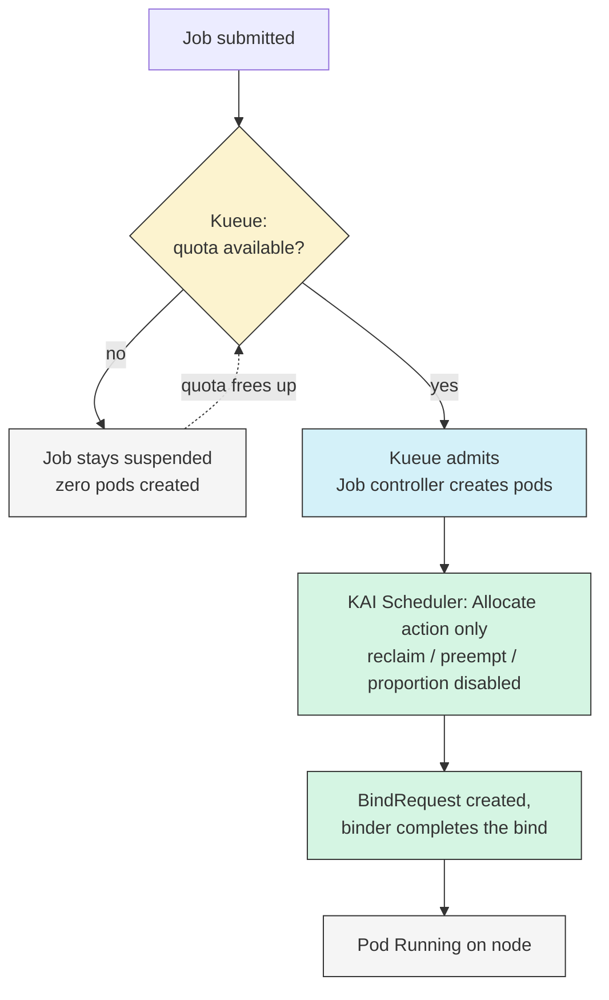
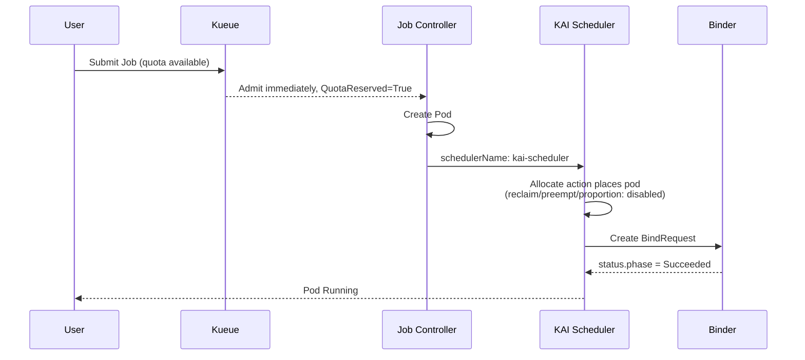
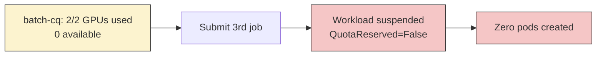
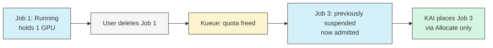
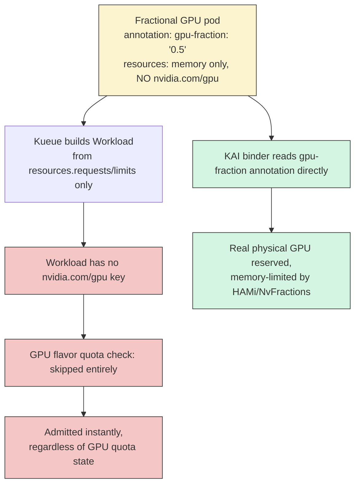
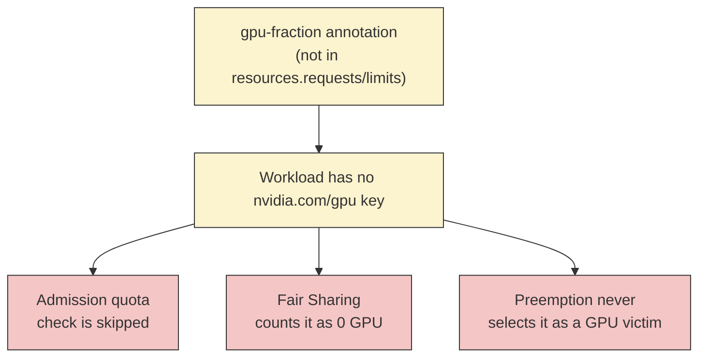

# Kueue Admission with KAI Placement

Teams already running [Kueue](https://kueue.sigs.k8s.io/) for cross-team quota and job queueing
can keep Kueue as the sole admission authority while using KAI Scheduler purely for pod
placement — gang-aware scheduling, bin-packing, topology-awareness, and fractional GPU sharing —
without KAI's own quota/fairness machinery double-gating admission decisions Kueue already made.

This pattern follows the approach discussed in
[KAI-Scheduler#68](https://github.com/kai-scheduler/KAI-Scheduler/issues/68) and has been
validated end-to-end on GKE `v1.35.8-gke.1036000` with NVIDIA T4s, KAI Scheduler `v0.14.1`,
and Kueue `v0.14.4`.

> **Summary:** this pattern has a real downside, not just a setup cost. Kueue cannot enforce
> quota or fair-sharing for fractional-GPU workloads (`gpu-fraction` annotation) — it only sees
> standard `resources.requests/limits`, and fractional GPU is deliberately expressed outside
> that field. The obvious fix — turning KAI's own `proportion` plugin back on so KAI enforces
> quota itself — brings back the exact problem this pattern exists to avoid: both Kueue and KAI
> independently gating admission, with no single source of truth. See
> [Known limitations](#known-limitations-fractional-gpu-bypasses-kueues-quota-enforcement) for
> the full breakdown.

## Table of Contents
- [Architecture](#architecture)
- [Prerequisites](#prerequisites)
- [Installation](#installation)
- [Usage](#usage)
- [Validated scenarios](#validated-scenarios)
  - [Scenario 1: quota available — job admitted and placed immediately](#scenario-1-quota-available--job-admitted-and-placed-immediately)
  - [Scenario 2: quota full — job stays suspended, zero pods created](#scenario-2-quota-full--job-stays-suspended-zero-pods-created)
  - [Scenario 3: quota full, then freed by deleting a running job](#scenario-3-quota-full-then-freed-by-deleting-a-running-job)
- [Known limitations: fractional GPU bypasses Kueue's quota enforcement](#known-limitations-fractional-gpu-bypasses-kueues-quota-enforcement)
  - [Why Kueue can't see fractional GPU requests](#why-kueue-cant-see-fractional-gpu-requests)
  - [Proof: admitted despite a fully saturated GPU quota](#proof-admitted-despite-a-fully-saturated-gpu-quota)
  - [Summary: what breaks for fractional GPU](#summary-what-breaks-for-fractional-gpu)
  - [Tradeoff 1: Disabling KAI's proportion plugin](#tradeoff-1-disabling-kais-proportion-plugin)
  - [Tradeoff 2: Kueue's Fair Sharing is also blind to fractional GPU](#tradeoff-2-kueues-fair-sharing-is-also-blind-to-fractional-gpu)
    - [Fair Sharing](#fair-sharing)
    - [Preemption](#preemption)

## Architecture



Kueue decides **when** a pod is allowed to exist at all; KAI decides **where** it runs once it
does. Neither layer's quota math runs twice — KAI's own `Queue` objects are configured with an
effectively infinite quota so they never independently block anything Kueue has already admitted.

### Division of responsibilities

Disabling KAI's `reclaim`/`preempt`/`proportion` doesn't remove those capabilities from the
cluster — it moves responsibility for some of them to Kueue, while others stay with KAI
unaffected (they don't depend on the disabled mechanisms at all):

| Capability | Who provides it in this pattern | Notes |
|---|---|---|
| Admission quota | **Kueue** (`ClusterQueue`) | The entire point of this pattern. |
| Preemption | **Kueue**, if you enable it | Kueue preempts at the *Workload* level — it evicts/suspends the whole Job via its integration, independent of which node(s) KAI placed its pods on. KAI never needs to be involved in a Kueue-driven preemption decision. This pattern doesn't configure it — it's off by default in a plain `ClusterQueue` (ours used `Within Cluster Queue: Never`). To enable it, set `preemption.withinClusterQueue`/`reclaimWithinCohort`/`borrowWithinCohort` on your `ClusterQueue` per [Kueue's own preemption docs](https://kueue.sigs.k8s.io/docs/concepts/preemption/) — nothing in this pairing needs to change for it to work. |
| Reclaim (voluntary) | **Kueue** | Validated directly (see [Scenario 3](#scenario-3-quota-full-then-freed-by-deleting-a-running-job)): when a running job is deleted or completes, Kueue's own requeue logic admits the next suspended workload. This is reclaim-by-completion, not active eviction. |
| Bin packing | **KAI** (`Allocate` action) | Unaffected — implemented via node/GPU-ordering plugins that run during placement, independent of `reclaim`/`preempt`/`proportion`. |
| Gang scheduling | **KAI** (`Allocate` action + pod-grouper) | Unaffected — gang-aware `minMember` checks happen inside `Allocate` itself. |
| Fair share | **Kueue** (Fair Sharing), **not** KAI | KAI's fair-share is implemented by the `proportion` plugin, which this pattern disables. If you need fairness between teams/queues, configure it via Kueue's own Fair Sharing (cohorts, weights), not KAI's `Queue` objects. |
| Stale gang cleanup | **KAI** (`StaleGangEviction` action) | Unaffected, and **not** a quota/fairness mechanism — it evicts a gang that's sat partially-allocated past its `PodGroup`'s staleness grace period without ever reaching `minMember`. It doesn't read `Queue` quota or depend on `proportion`, so it's intentionally left enabled. This is the action you'll see firing continuously (every ~1s) in the Scenario 3 log proof below, alongside `Allocate`. |

The practical takeaway: this pattern doesn't just "turn off" parts of KAI — it reassigns
admission-time decisions (who gets in, who gets preempted, who's treated fairly) to Kueue
entirely, while leaving placement-time decisions (which node, which GPU, gang atomicity) with
KAI. Don't expect KAI's `Queue` priority/weight settings to have any effect in this pattern —
they won't, since `proportion` is off.

## Prerequisites

- Kueue already installed and managing the `ClusterQueue`/`LocalQueue` you want to pair with.
- KAI Scheduler installed, with a `SchedulingShard` you can customize (see
  [Scheduler Config Customization](../operator/scheduler-config-customization.md)).

## Installation

### 1. Mirror your Kueue queue(s) into KAI, with effectively infinite quota

`limit: -1` is the real "no ceiling" sentinel; `quota` has no such sentinel, so set it to a
number comfortably above anything this queue could ever request — Kueue's own `ClusterQueue`
quota is the real limit being enforced.

> **Note:** both `quota` and `limit` here are inert while `proportion` is disabled (see
> [Tradeoff 1](#tradeoff-1-disabling-kais-proportion-plugin)) — the only code anywhere in KAI
> that reads a `Queue`'s `quota`/`limit` values lives inside the `proportion` plugin itself, so
> with it off, these numbers are never evaluated regardless of what they're set to. They're kept
> here for forward-compatibility in case you ever re-enable `proportion` (which this doc
> recommends against), not because the specific values matter today.

```yaml
apiVersion: scheduling.run.ai/v2
kind: Queue
metadata:
  name: kai-batch-queue
spec:
  resources:
    gpu:
      quota: 1000
      limit: -1
      overQuotaWeight: 1
    cpu:
      quota: 1000
      limit: -1
      overQuotaWeight: 1
    memory:
      quota: 1000
      limit: -1
      overQuotaWeight: 1
```

### 2. Disable KAI's own quota/fairness actions on the relevant SchedulingShard

```yaml
apiVersion: kai.scheduler/v1
kind: SchedulingShard
metadata:
  name: default
spec:
  actions:
    reclaim:
      enabled: false
    preempt:
      enabled: false
  plugins:
    proportion:
      enabled: false
```

**This affects every workload on the shard**, not just the ones using this pattern. If other
workloads on the same shard rely on KAI's own fair-share/preemption, consider a dedicated
`SchedulingShard` scoped to just this pool instead of patching a shared one.

## Usage

Label the pod template with **both** Kueue's queue label (for admission) and KAI's scheduler
opt-in plus queue label (for placement):

```yaml
apiVersion: batch/v1
kind: Job
metadata:
  name: example-job
spec:
  template:
    metadata:
      labels:
        kueue.x-k8s.io/queue-name: batch-queue   # Kueue: admission/suspend
        kai.scheduler/queue: kai-batch-queue      # KAI: placement queue (infinite quota)
    spec:
      schedulerName: kai-scheduler                 # KAI: opt in for placement
      containers:
        - name: main
          image: your-image
          resources:
            limits:
              nvidia.com/gpu: "1"
```

## Validated scenarios

Three scenarios were tested end-to-end on dev52 (`dev52-gpu-autoscale`, GKE
`v1.35.8-gke.1036000`, NVIDIA T4s, KAI Scheduler `v0.14.1`, Kueue `v0.14.4`) against a
`batch-cq` `ClusterQueue` with `nominalQuota: 2` for `nvidia.com/gpu`, and reported on
[KAI-Scheduler#68](https://github.com/kai-scheduler/KAI-Scheduler/issues/68).

### Scenario 1: quota available — job admitted and placed immediately



```
$ kubectl get workload -n default
job-kueue-kai-poc-job-ac527   batch-queue   batch-cq   True   8s

$ kubectl get pods -n default -l job-name=kueue-kai-poc-job -o wide
kueue-kai-poc-job-lwwpq   1/1   Running   0   13s   <node>

$ kubectl get bindrequest kueue-kai-poc-job-c6f6l -n default -o yaml
spec:
  receivedGPU: {count: 1, portion: "1.00"}
  receivedResourceType: Regular
status:
  phase: Succeeded
```

**Result:** admitted and running within seconds, via KAI's real `BindRequest` path. Confirmed
on two independent submissions.

### Scenario 2: quota full — job stays suspended, zero pods created



```
$ kubectl describe workload job-kueue-kai-poc-job-3-38cce -n default
Status:
  Conditions:
    Message:  couldn't assign flavors to pod set main: insufficient unused quota
              for nvidia.com/gpu in flavor t4-flavor, 1 more needed
    Reason:   Pending
    Status:   False
    Type:     QuotaReserved

$ kubectl get pods -n default -l job-name=kueue-kai-poc-job-3
No resources found in default namespace.
```

**Result:** zero pods created while suspended, with a genuine quota reason. Confirmed on two
independent submissions, against `batch-cq`'s real `nominalQuota: 2` for `nvidia.com/gpu`. KAI
is never even consulted — the job never reaches a pod, let alone the scheduler.

### Scenario 3: quota full, then freed by deleting a running job

This is the direct validation of the real motivation for this pattern — reclaiming idle GPU
capacity through Kueue's own requeue logic, with KAI's `reclaim`/`preempt` never invoking at
all:



```
$ kubectl delete job kueue-kai-poc-job-2
job.batch "kueue-kai-poc-job-2" deleted

$ kubectl get workload -n default | grep kueue-kai-poc-job-3
job-kueue-kai-poc-job-3-38cce   batch-queue   batch-cq   True   2m27s

$ kubectl get bindrequest kueue-kai-poc-job-3-5tvgg -n default -o yaml
status:
  phase: Succeeded
```

**Result:** no manual intervention was required between deleting the running job and the
previously-suspended one reaching `Running` — Kueue's own requeue logic and KAI's `Allocate`
action handled the whole path, confirming reclaim-by-deletion works without KAI's own
reclaim/preempt machinery running at all:

```
$ kubectl logs -n kai-scheduler deploy/kai-scheduler-default --since=2m | grep -E "Enter (Reclaim|Preempt)"
(no output)

$ kubectl logs -n kai-scheduler deploy/kai-scheduler-default --since=2m | grep -E "Enter (Allocate|StaleGangEviction)"
2026-10-22T14:34:08.086Z  [allocate] Enter Allocate ...
2026-10-22T14:34:08.086Z  [stalegangeviction] Enter StaleGangEviction ...
... (continues every ~1s)
```

## Known limitations: fractional GPU bypasses Kueue's quota enforcement

Kueue's admission quota is **blind to fractional GPU requests**. This is not a bug or a
misconfiguration — it is a structural consequence of how KAI's fractional GPU support works, and
it applies to this pattern every time, deterministically.

```yaml
apiVersion: batch/v1
kind: Job
metadata:
  name: example-fraction-job
spec:
  template:
    metadata:
      labels:
        kueue.x-k8s.io/queue-name: batch-queue   # Kueue: admission/suspend
        kai.scheduler/queue: kai-batch-queue      # KAI: placement queue (infinite quota)
      annotations:
        gpu-fraction: "0.5"                       # the entire GPU ask — not a resource field
    spec:
      schedulerName: kai-scheduler                 # KAI: opt in for placement
      containers:
        - name: main
          image: your-image
          resources:
            limits:
              memory: 1Gi
              # deliberately no nvidia.com/gpu here — that's the whole point of this example
```

Compare this to the whole-GPU example in [Usage](#usage): identical Kueue/KAI labels, but no
`nvidia.com/gpu` anywhere in `resources`. That absence is exactly what makes Kueue's quota check
skip this workload's GPU usage entirely, as shown below.



The two branches below the pod show the gap directly: Kueue (top path, red) never sees a GPU
request at all, while KAI (bottom path, green) correctly reads the same pod's fractional GPU
ask and places it on real hardware. Kueue's admission decision and KAI's actual resource
consumption are computed from two different views of the same pod.

### Why Kueue can't see fractional GPU requests

KAI's fractional GPU support (`gpu-fraction` annotation) is deliberately not expressed as a
standard Kubernetes resource — `nvidia.com/gpu` is an integer-only extended resource, so
`nvidia.com/gpu: "0.5"` is rejected by the API server outright. KAI's own admission webhook goes
further and actively rejects combining the two:

```
cannot have both GPU fraction request and whole GPU resource request/limit
```

(from `ValidateGPUFractionRequest` in `kai-scheduler/api`'s `utilities/resources` package)

So a fractional-GPU pod's `resources.requests/limits` can never contain `nvidia.com/gpu` at all
— the entire GPU ask lives only in the `gpu-fraction` annotation. Kueue builds its `Workload`
object purely from `resources.requests/limits`, so a fractional pod's `Workload` has no GPU entry
whatsoever. Kueue's admission check only evaluates resources that are present in the `Workload`;
with no `nvidia.com/gpu` key, there is nothing for Kueue to check the GPU flavor's quota against,
so that flavor is skipped entirely for this workload.

### Proof: admitted despite a fully saturated GPU quota

Kueue will admit any number of fractional-GPU jobs regardless of how full the GPU quota is.
Validated directly: with `batch-cq`'s `nvidia.com/gpu` quota fully saturated (`2/2`, `0`
available, by two whole-GPU jobs), a new job requesting `gpu-fraction: "0.5"` was still admitted
in seconds:

```bash
$ kubectl describe clusterqueue batch-cq | grep -A8 "Flavors Usage"
  Flavors Usage:
    Name:  t4-flavor
    Resources:
      ...
      Name:             nvidia.com/gpu
      Total:            2          # fully saturated — 0 available
  Reserving Workloads:  3          # yet a 3rd workload (the fractional job) was still admitted

$ kubectl get workload <fractional-job-workload> -n default -o jsonpath='{.status.admission}'
# resourceUsage only ever contains {"memory": "..."} — no nvidia.com/gpu key, confirming
# Kueue never evaluated a GPU request for this workload at all.
```

The pod itself placed and ran normally — KAI's scheduler correctly reads the annotation and
assigns real GPU hardware. The gap is purely in Kueue's accounting: its "admitted" state, queue
depth, and quota utilization metrics for `nvidia.com/gpu` become unreliable once fractional-GPU
workloads are mixed into a ClusterQueue that also runs whole-GPU workloads, since fractional
usage is invisible to it.

We also confirmed there is no YAML-level workaround — attempting to set a whole-unit
`nvidia.com/gpu: "1"` alongside the `gpu-fraction` annotation (to force Kueue to see *some* GPU
request) is explicitly rejected by KAI's admission webhook with the error quoted above. The two
fields are mutually exclusive by design.

### Summary: what breaks for fractional GPU

The root cause is the same in every row below: a fractional-GPU `Workload` has no
`nvidia.com/gpu` entry anywhere in its resource data, because the entire GPU ask lives only in
the `gpu-fraction` annotation. Every mechanism that depends on reading that resource data —
whether in Kueue or in KAI — is blind to fractional GPU as a result. Nothing in this pairing
currently sees fractional-GPU usage as GPU usage at all.



One root cause, three separate blind spots — all downstream of the same missing resource key:

| Capability | Status for fractional GPU | Detail |
|---|---|---|
| Admission quota | **Bypassed** — admitted regardless of how full the GPU quota is | See above |
| Fair share (Kueue Fair Sharing) | **Blind** — counted as zero GPU usage, even when enabled | [Tradeoff 2 → Fair Sharing](#fair-sharing) |
| Preemption (Kueue) | **Can't target** — never selected as a victim to free GPU capacity | [Tradeoff 2 → Preemption](#preemption) |
| Fair share / quota (KAI `proportion`) | **Off by design** in this pattern; turning it back on fixes quota but reintroduces double-gating | [Tradeoff 1](#tradeoff-1-disabling-kais-proportion-plugin) |

The practical conclusion: in this pattern, fractional-GPU workloads get real hardware placement
from KAI, but they are invisible to every admission, fairness, and preemption decision on the
Kueue side. Capacity planning, team fairness, and contention resolution for fractional GPU all
have to happen outside this pairing today — there is no configuration of either system, as
currently architected, that closes this gap.

### Tradeoff 1: Disabling KAI's `proportion` plugin

This pattern disables KAI's `proportion` plugin, and that choice is what causes the
fractional-GPU gap above. It's worth being explicit about what that one setting trades away, and
why giving KAI's `Queue` a real GPU number doesn't get it back.

**What disabling `proportion` gets you:** a single, clean source of truth. Kueue is the only
system checking quota, so there's exactly one place to look when a job won't run, and no risk of
two systems disagreeing.

**What it costs you:** KAI stops checking its own `Queue`'s quota entirely — not just for GPU,
for every resource. Quota checking and fair-share are the same on/off switch inside KAI (the
`proportion` plugin); the code that compares a job's request against its `Queue`'s quota lives
inside that plugin, so when the plugin is off, that code never runs at all. This is why putting
a real GPU number on KAI's `Queue` doesn't help — there's no check left to read that number. The
only way to get the check back is to turn `proportion` back on, and that switch doesn't separate
"quota checking" from "fair-share" — it's one switch for both.

| | `proportion` disabled (this pattern's default) | `proportion` enabled |
|---|---|---|
| CPU / memory / whole-GPU quota | Enforced once, by Kueue only | Enforced **twice** — by Kueue and KAI independently |
| Fractional GPU quota | **Not enforced anywhere** (this limitation) | Enforced by KAI (it understands `gpu-fraction`) |
| Source of truth when a job won't run | One place: Kueue's `Workload` status | Two places — a job can be allowed by one system and rejected by the other |
| Risk if the two quota numbers drift | None — only one number exists | A job Kueue admits can get stuck `Pending` forever because KAI separately refuses to place it, with no clear "suspended, waiting on quota" signal |
| KAI fair-share / queue ordering | Off | Back on — same plugin, so this is a bundled side effect, not a choice |
| KAI `reclaim` / `preempt` (forced eviction) | Off | Still off — these are separate `actions.*.enabled` switches, unaffected by `proportion` |

**Verdict:** enabling `proportion` plugs the fractional-GPU gap, but it does so by reintroducing
double-gating — just moved from `reclaim`/`preempt` (which this pattern already disables for
this reason) onto quota itself, with a worse failure mode (silent stuck `Pending`) than today's
clear "suspended, insufficient quota" message. We recommend keeping `proportion` disabled and
treating fractional GPU as an accepted gap (see [Summary](#summary-what-breaks-for-fractional-gpu)
above) rather than trading one double-gating problem for another.

### Tradeoff 2: Kueue's Fair Sharing is also blind to fractional GPU

#### Fair Sharing

A natural follow-up: if KAI's fair-share (`proportion`) is off, can Kueue's own Fair Sharing
feature cover fairness instead? For CPU, memory, and whole-GPU, yes. For fractional GPU, no —
and it's the same root cause as the quota gap above, not a separate problem.

Kueue's Fair Sharing calculates each queue's "share" of resource usage from the exact same data
as its quota check: the `Workload`'s `resources.requests/limits`. We already confirmed a
fractional-GPU `Workload` has no `nvidia.com/gpu` entry at all — only `memory`. So Fair Sharing's
math would count a queue running ten fractional-GPU jobs, consuming real physical GPUs, as using
**zero** GPU. Not under-counted — invisible, in exactly the same way the quota check is blind to
it.

**What this means:** enabling Kueue's Fair Sharing restores fairness for CPU, memory, and
whole-GPU workloads, since those are expressed as real resource fields Kueue reads correctly.
It does **not** restore fairness for fractional-GPU workloads, because the gap isn't in Kueue's
Fair Sharing logic — it's in what data ever reaches either system's accounting for this resource
type at all. Turning on Fair Sharing is a real, valid mitigation for Tradeoff 1's loss of
KAI-side fairness, but it doesn't close the fractional-GPU gap described earlier in this
document, and nothing we tested does.

#### Preemption

The same gap surfaces a third time in preemption, with a sharper consequence. Kueue's
preemption-victim selection uses this same `resourceUsage` data to decide which running
`Workload` to evict in order to free up a contended resource for a higher-priority one waiting.
Since a fractional-GPU `Workload` shows zero GPU usage, **Kueue can never select a
fractional-GPU job as a victim to free GPU capacity** — even though evicting one would physically
free a real GPU, Kueue's accounting gives it no reason to think so. Mechanically Kueue can still
evict a fractional-GPU job's `Workload` (preemption works by evicting the whole Job via the
job-controller integration, which doesn't require knowing what resource is freed), so it could
still be preempted for unrelated reasons (e.g. priority-class rules) — just never specifically to
relieve GPU pressure. Net effect: in a cluster mixing whole-GPU and fractional-GPU workloads,
Kueue's preemption can only correctly target whole-GPU jobs for GPU-driven eviction;
fractional-GPU jobs are invisible to that targeting logic entirely.
